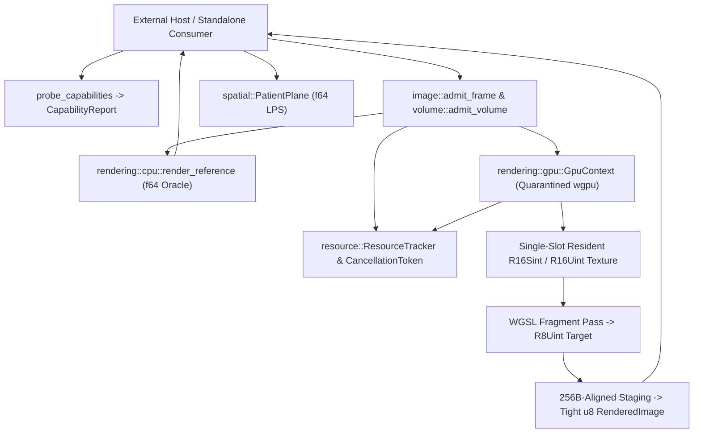

# DICOMflux-3D First Slice (FS-01): Checked 2D Greyscale Presentation and Spatial Geometry Foundation

*   **Author**: Ranjith Kumar (`ranjithkumar.k@raster.in`)
*   **Status**: Approved
*   **Date**: 2026-11-11

--------------------------------------------------------------------------------

## Overview

This document specifies **First Slice (`FS-01`)** of `dicomflux-3d`, a proposed standalone, MIT-licensed Rust library owned by Raster Images for medical greyscale image presentation and three-dimensional spatial geometry on Windows and Linux (`x86_64` and `aarch64`), using `wgpu` and WebGPU Shading Language (`WGSL`) for GPU execution.

Within Raster Images' existing software portfolio, Apple platforms (macOS and iOS) rely on Swift libraries: **DICOMkit** (DICOM file parsing and dataset handling), **Swift Imaging Suite (`SIS`)** (image compression codecs and resampling), and **Voxelia** (Metal-based 2D/3D medical rendering). No equivalent Rust presentation or spatial-geometry library exists today for Windows and Linux workstations or headless services, and an earlier experimental C++ `DICOMflux` prototype has been retired and excluded from source authority.

To support cross-platform targets without coupling parsing, codecs, rendering, and user interfaces into a monolith, Raster Images split the new Rust programme ([DICOMflux_and_Flux_Imaging_Suite_Development_Manifesto_v1.3.1.md](../handoff/DICOMflux/DICOMflux_and_Flux_Imaging_Suite_Development_Manifesto_v1.3.1.md)) into three independent library tracks and one desktop demonstrator:

1.  **`DICOMflux`** (work orders [D0](../handoff/DICOMflux/DICOMflux_D0_Foundation_Work_Order_v0.1.0.md) and `D1`): Rust DICOM core types, resource budgets, C application binary interface (`ABI`), and bounded DICOM Part 10 file reading.
2.  **`Flux Imaging Suite`** (work orders [F0](../handoff/Flux_Imaging_Suite/Flux_Imaging_Suite_F0_Foundation_Work_Order_v0.1.0.md) and `F1`): DICOM-independent Rust image buffer descriptors, memory leases, Run-Length Encoding (`FluxRLE`), and resampling (`FluxResample`).
3.  **`DICOMflux-3D`** (governed by owner-approved architectural decisions `DF3D-DEC01` through `DF3D-DEC09` in [06_Decisions_References_and_Licences_v0.2.0.md](../handoff/DICOMflux-3D/06_Decisions_References_and_Licences_v0.2.0.md), starting with First Slice **`FS-01`** in [02_First_Slice_SRS_v0.2.0.md](../handoff/DICOMflux-3D/02_First_Slice_SRS_v0.2.0.md)): A one-way downstream consumer of decoded pixel buffers and spatial metadata that performs DICOM intensity presentation and GPU-accelerated 2D/3D visualisation without parsing DICOM files, running codecs, or owning GUI windows.
4.  **`DICOM Capacitor`**: A future Java 25 and Swing desktop demonstrator on Windows and Linux that will consume the public Rust library interfaces.

`FS-01` establishes the memory ownership seam, DICOM mathematical presentation accuracy, GPU capability probing and quota enforcement, and three-dimensional coordinate validation in a narrow, testable Rust crate before later slices add Multi-Planar Reconstruction (`FS-02`), Maximum Intensity Projection and Direct Volume Rendering (`FS-03`), or threshold segmentation overlays (`FS-04`).

## The Problem

Medical imaging applications cannot treat decoded 16-bit DICOM pixel buffers as ordinary 8-bit photographs or pass unvalidated byte slices directly to GPU shaders without introducing four failure modes:

1.  **Quantitative Value Corruption and Formula Drift**: Raw stored 16-bit integer samples (`i16` or `u16`, often holding 12-bit signed CT values or padded background markers) are distinct from modality-rescaled physical values (such as Hounsfield Units computed via linear `slope` and `intercept`) and 8-bit display pixels. Mutating source buffers in place, applying generic contrast sliders instead of the DICOM PS3.3 Value of Interest (`VOI`) `LINEAR` half-sample equation, or delegating rounding to GPU fixed-function hardware produces inconsistent visual thresholds across Direct3D 12, Vulkan, and Metal drivers.
2.  **Spatial Coordinate Transposition and Invalid Volume Geometry**: DICOM expresses physical coordinates in the patient **Left-Posterior-Superior (`LPS`)** millimetre frame, where `ImageOrientationPatient` lists column-step then row-step direction cosines while `PixelSpacing` lists row spacing before column spacing. Truncating authoritative `f64` coordinates to `f32`, inferring slice spacing from nominal `SliceThickness` instead of slice positions, or confusing row and column strides silently distorts anatomical location.
3.  **Unbounded GPU Memory, Deadlocks, and Driver Crashes**: Allocating GPU staging buffers and textures without pre-checking adapter capabilities and byte quotas—including `wgpu`'s mandatory 256-byte row-copy alignment—causes out-of-memory panics on constrained machines. Furthermore, borrowed slice lifetimes or unpolled asynchronous GPU buffer mappings can dangle or deadlock when callers cancel requests or run outside a windowing event loop.
4.  **Cross-Library Dependency Entanglement**: Embedding a DICOM file parser, compression codec, or GUI framework (`egui`, `winit`, or Java Swing) inside the renderer prevents headless verification, bloats dependency audits, and forces breaking API rewrites when `DICOMflux` (`D0`/`D1`) and `Flux Imaging Suite` (`F0`) connect later.

**Proposed Solution Summary**: Build `dicomflux-3d` (`FS-01`) as a safe Rust crate (`#![forbid(unsafe_code)]`) whose direct runtime dependencies are `wgpu` and `sha2`, with zero DICOM parser, codec, or GUI crates in its transitive dependency closure. Callers supply validated 16-bit greyscale frame descriptors, reference-counted immutable buffer leases aligned with [F0](../handoff/Flux_Imaging_Suite/Flux_Imaging_Suite_F0_Foundation_Work_Order_v0.1.0.md) layout invariants, and `f64` LPS spatial metadata. `dicomflux-3d` provides a deterministic `f64` CPU reference renderer (`render_reference`), a self-polled synchronous offscreen `wgpu`/WGSL renderer (`render_offscreen`) that matches the CPU oracle without mutating source samples or re-uploading cached textures on window/level updates, standalone `f64` 2D plane and 3D regular-volume validators (`PatientPlane` and `CheckedVolume`), and privacy-safe execution receipts (`RenderReceipt`).

## Goals

Each goal maps 1:1 to mandatory requirements `FS01-R01` through `FS01-R18` ([02_First_Slice_SRS_v0.2.0.md](../handoff/DICOMflux-3D/02_First_Slice_SRS_v0.2.0.md)) and verification cases `FS01-T01` through `FS01-T24` ([FS01_Test_Case_Manifest_v0.2.0.json](../handoff/DICOMflux-3D/FS01_Test_Case_Manifest_v0.2.0.json)):

*   **Standalone Minimal Crate and Layering Isolation (`FS01-R01`, `FS01-R08`, `FS01-R16`, `FS01-R17`; `FS01-T01`, `FS01-T18`)**: Ship an MIT-licensed Rust crate owned by Raster Images with a pinned stable toolchain (`1.97.1`), committed lockfile, `#![forbid(unsafe_code)]`, automated dependency and licence checks confirming zero Swift, C++, DICOM parser, codec, or GUI crates in the dependency closure, and an executable consumer crate located outside the Cargo workspace.
*   **Immutable Checked 16-Bit Frame Admission and Negative-Profile Rejection (`FS01-R02`, `FS01-R03`, `FS01-R18`; `FS01-T02`, `FS01-T03`, `FS01-T08`, `FS01-T16`)**: Validate single-frame `i16` and `u16` greyscale descriptors, canonical bit precision (`BitsAllocated = 16`, `BitsStored`, `HighBit == BitsStored - 1`, signedness), stored-container pixel padding bounds, byte offsets, and even byte row strides using checked arithmetic without panicking or mutating source bytes, while explicitly rejecting multiframe, non-16-bit (`u8`/`i32`/`f32`), colour/palette, and nonlinear Modality or VOI LUT profiles.
*   **Authoritative `f64` Patient LPS Spatial Validation (`FS01-R04`; `FS01-T10`, `FS01-T11`)**: Validate 2D `PatientPlane` orientation, spacing, and origin conversions plus 3D `CheckedVolume` regular affine matrices, invertibility, and orthogonality in `f64` arithmetic using constant (`O(1)`) CPU memory and without inferring slice spacing from filenames or `SliceThickness`.
*   **Deterministic CPU Reference and Parity-Verified Offscreen GPU Windowing (`FS01-R05`, `FS01-R06`, `FS01-R07`, `FS01-R13`; `FS01-T04`, `FS01-T05`, `FS01-T06`, `FS01-T07`, `FS01-T12`, `FS01-T17`)**: Implement stored-domain pixel padding, finite linear modality rescale, DICOM PS3.3 `LINEAR` window centre/width (`width >= 1`), and `MONOCHROME1`/`MONOCHROME2` polarity in both an analytic `f64` CPU oracle and an offscreen `wgpu`/WGSL pipeline producing tight 8-bit uncalibrated sRGB greyscale buffers with explicit provenance receipts, zero threshold-branch divergence, and at most `1` output-code difference on interior ramp pixels.
*   **Zero-Reupload Window/Level Updates (`FS01-R09`; `FS01-T14`)**: Update window centre, width, padding display code, or polarity on a resident GPU frame via uniform parameters without mutating CPU source bytes or re-uploading source pixel textures, reporting uploaded byte counts explicitly in `RenderReceipt`.
*   **Pre-Work Capability Probing, Bounded Quotas, and Safe Fault Isolation (`FS01-R10`, `FS01-R11`, `FS01-R12`; `FS01-T09`, `FS01-T13`, `FS01-T15`)**: Return structured CPU/GPU capability reports prior to rendering, enforce checked quotas across retained source, upload staging, resident GPU textures, readback staging, CPU output, volume bytes, dimensions, and in-flight jobs before allocation, and convert adapter absence, capability mismatches, out-of-memory faults, device loss, and cooperative cancellation into typed `RenderError` outcomes with zero partial-success outputs.
*   **Privacy-Safe Provenance, Baseline Telemetry, and Platform Qualification Honesty (`FS01-R14`, `FS01-R15`; `FS01-T19`, `FS01-T20`, `FS01-T21`, `FS01-T22`, `FS01-T23`, `FS01-T24`)**: Exclude patient identifiers, UIDs, filesystem paths, pixel payloads, and raw driver text from default diagnostics, emit reproducible test, performance, SBOM, and SHA-256 evidence bundles alongside explicit non-clinical scope notices, and stamp macOS Metal runs as `BoundedDevelopmentHost` while keeping physical Windows `x86_64` (`FS01-T19`), Linux `x86_64` (`FS01-T20`), and `ARM64` (`FS01-T21`) gates marked `NOT_RUN` (`OPEN`) until executed on target hardware.

## Non-Goals

*   **No DICOM Parsing, Codecs, or Resampling**: `dicomflux-3d` will not read DICOM Part 10 files, parse tags/UIDs, decode compressed transfer syntaxes (`RLE`, `JPEG`, `JPEG-LS`, `JPEG 2000`, `HTJ2K`, `JPEG XL`), write DICOM Segmentation (`SEG`) or Structured Report (`SR`) objects, or implement generic 2D/3D image resampling.
*   **No Volumetric Rendering or Segmentation in `FS-01`**: Multi-planar reconstruction (`MPR`), maximum/minimum intensity projection (`MIP`/`MinIP`), direct volume rendering (`DVR`), 3D GPU texture uploads, bricked volume streaming, transfer-function editors, threshold masks, Marching Cubes surface extraction, and `parry3d` spatial queries are deferred to `FS-02` and subsequent work orders.
*   **No Unqualified Presentation or Sample Subprofiles in `FS-01`**: Multiframe (`frame_count > 1`), `u8`/`i32`/`f32`/colour/palette inputs, `LINEAR_EXACT` and `SIGMOID` VOI functions, nonlinear Modality or VOI Lookup Tables (`LUT`s), Grayscale Softcopy Presentation States (`GSPS`), and DICOM PS3.14 Grayscale Standard Display Function (`GSDF`) calibration are excluded and deterministically rejected with `UnsupportedPixelFormat` or `UnsupportedPresentation`.
*   **No GUI, Foreign Language Bindings, Mobile/Web Targets, or Clinical Claims**: `egui`/`winit` windows, C-ABI headers, Java/Swing `DICOM Capacitor` integration, Android Kotlin/JNI/AAR builds, browser/WebGPU builds, and medical-device clinical qualification are out of scope for `FS-01`.

## Open Questions

*   **Question 1 (Preflight Kickoff vs. Primary Hardware Qualification Gates — [07_Admission_and_Review_Checklist_v0.2.0.md](../handoff/DICOMflux-3D/07_Admission_and_Review_Checklist_v0.2.0.md))**:
    1. *Pre-`F0` Kickoff Confirmation*: Confirm work-order identifier (`FS-01`), named human reviewer, local Git initialization on `main`, and pinned DICOM PS3.3 `2026d` clause references before starting Checkpoint `F0`.
    2. *Post-Development Remote & Hardware Assignment*: Identify the target `https://github.com/raster-labs/<repo>` remote URL and physical Windows `x86_64` (D3D12/Vulkan, `FS01-T19`), Linux `x86_64` (Vulkan, `FS01-T20`), and `ARM64` (`FS01-T21`) runners to close the primary platform qualification gates after local `BoundedDevelopmentHost` verification completes.

## Critical User Journeys (CUJs)

### CUJ 1: Headless Consumer Evaluates CPU Reference vs. Offscreen GPU Window/Level Parity

*   **Given**: An external Rust binary outside the `dicomflux-3d` workspace constructs a synthetic `512 x 512` signed 12-bit (`i16`) greyscale frame with stored pixel padding `-2000`, CT linear rescale (`slope = 1.0`, `intercept = -1024.0`), `MONOCHROME2` polarity, a `ResourceTracker` configured with bounded `ResourceLimits`, and an initialized `GpuContext`.
*   **When**: The caller admits the frame once into a `CheckedFrame` and invokes both `render_reference` (CPU) and `render_offscreen` (GPU) with a DICOM `LINEAR` `VoiRequest` (`centre = 40.0`, `width = 400.0`), then submits a second `render_offscreen` call on the same `CheckedFrame` with `centre = -600.0`, `width = 1500.0`.
*   **Then**: Both renders return tight `512 x 512` 8-bit `RenderedImage` outputs whose padded pixels match the configured background code, threshold boundary pixels match the `f64` PS3.3 formula with zero branch error, interior pixels agree within `<= 1` code, source frame bytes remain bit-identical before and after rendering, and the second GPU `RenderReceipt` reports `source_bytes_uploaded == 0` (`source_cache_hit == true`).

### CUJ 2: Host Probes Capabilities and Handles Constrained Budgets or GPU Faults Safely

*   **Given**: A host application runs on a headless CI runner with no hardware GPU adapter, or submits a `CheckedFrame` whose 256-byte row-aligned GPU upload staging footprint exceeds `ResourceLimits::gpu_staging_upload_bytes` by 1 byte, or experiences a simulated device loss / cancellation mid-operation.
*   **When**: The caller first queries `probe_capabilities`, then attempts `GpuContext::new` or `render_offscreen`.
*   **Then**: `probe_capabilities` succeeds without panicking and reports CPU availability, GPU unavailability or qualification tier (`BoundedDevelopmentHost` vs. `PrimaryTargetCandidate`), and excluded profiles with typed reasons; any disallowed `GpuContext::new` or `render_offscreen` call fails deterministically with `NoSuitableAdapter`, `ResourceLimitExceeded`, `Cancelled`, or `GpuDeviceLost` before mutating caller state, leaks zero raw driver text or PHI to `stderr`, and never emits a partially written `RenderedImage`.

### CUJ 3: Upstream Adapter Validates Patient LPS 2D Plane and Regular 3D Volume Geometry

*   **Given**: A caller provides `f64` DICOM spatial metadata for (a) an oblique 2D `PatientPlane` (`origin_lps_mm`, row/column direction cosines, row/column millimetre spacings) and (b) a `512 x 512 x 1024` regular `CheckedVolume` affine (including both right-handed `det > 0` and left-handed `det < 0` clinical axial slice orderings, as well as malformed singular or gantry-sheared test cases).
*   **When**: The caller constructs `PatientPlane` and `CheckedVolume` descriptors and maps pixel/voxel indices to LPS millimetre coordinates and back.
*   **Then**: Valid orthogonal descriptors construct in `O(1)` memory without allocating voxel buffers or 3D GPU textures and round-trip `(col, row)` / `(i, j, k)` <-> `(L, P, S)` in `f64` within analytical tolerance, while zero/negative spacings, non-orthonormal cosines, singular matrices, or sheared gantry-tilted grids fail closed with `UnsupportedGeometry` or `InvalidDescriptor`.

## Technical Plan (Architecture)

### 1. Component Boundaries and Dependency Isolation

`dicomflux-3d` is structured as a single library crate with `#![forbid(unsafe_code)]` at the crate root. Its direct `[dependencies]` are `wgpu` (`30.0.1`, native desktop backends only) for GPU execution and `sha2` (`0.11`, following [DICOMflux_and_Flux_Imaging_Suite_Development_Manifesto_v1.3.1.md](../handoff/DICOMflux/DICOMflux_and_Flux_Imaging_Suite_Development_Manifesto_v1.3.1.md) §2.2 maintained-cryptography guidance) for shader and evidence SHA-256 digests, with `serde_json` (`1`) confined to `[dev-dependencies]` for `cargo metadata` and evidence JSON verification. Zero DICOM parsers, compression codecs, third-party linear-algebra crates (`glam`, `ndarray`), byte-casting macro crates (`bytemuck`), async executors (`tokio`, `pollster`), or UI/windowing toolkits (`egui`, `winit`) are permitted in the crate's transitive runtime dependency closure (`FS01-R08`, `FS01-R17`).

Internally, the crate is partitioned into seven private modules with an acyclic one-way dependency order (`camera` and `segmentation` are deferred beyond `FS-01` to avoid unused scaffolding):

*   `error`: Structured `#[non_exhaustive]` `RenderError` taxonomy, `LimitPoolKind`, and privacy-redacted formatting.
*   `resource`: `ResourceLimits` presets, `ResourceTracker` owning its governing `ResourceLimits`, internal RAII quota guards, live/peak `PoolUsageSnapshot` telemetry, `OperationId`, and cooperative `CancellationToken`.
*   `image`: `SourceIdentity`, segmented safe `DecodedFrameLease`, `FrameDescriptor` (including `ColorModel` and container-domain `PixelPadding`), `CheckedFrame`, and `F0`-aligned canonical 16-bit admission checks.
*   `spatial`: Self-contained `f64` DICOM patient `LPS` coordinate types, named-field `PatientPlane` validation, and forward/inverse 2D coordinate projection.
*   `volume`: Constant-memory `f64` regular 3D volume geometry (`CheckedVolume`), determinant/orthogonality conditioning checks, and forward/inverse 3D voxel-to-LPS transforms.
*   `presentation`: Immutable intensity and display value objects (`IntensityTransform`, `VoiParameters`, `VoiFunction`, `PhotometricPolarity`, `VoiRequest`, `DisplayEncoding`, `OutputDescriptor`, `RenderReceipt`, and `RenderedImage`).
*   `rendering`: Split into `rendering::cpu` (analytic `f64` reference implementation with zero GPU imports) and `rendering::gpu` (private quarantine boundary encapsulating all `wgpu` and Naga/WGSL types, `CapabilityReport` / `GpuCapabilities` adapter probing, single-slot texture residency, explicit staging/readback buffers, and stepped `device.poll` execution).

### 2. Immutable Frame Ownership and `F0`-Aligned Canonical Admission

To allow safe sharing across CPU threads, concurrent GPU submissions, and future C-ABI handles without `unsafe` lifetime casts or pixel copies:

*   **Segmented Reference-Counted Lease (`DecodedFrameLease`)**: Stores a private three-variant safe backing enum (`Bytes`, `WordsI16`, `WordsU16` over `Arc<dyn AsRef<[T]> + Send + Sync>`), the backing allocation's `retained_capacity_bytes`, and a caller-minted numeric `SourceIdentity { owner_id: NonZeroU64, generation: u64 }`. Constructors wrap `Arc<[u8]>`, `Arc<[i16]>`, `Arc<[u16]>`, and `Vec<u8 | i16 | u16>` (via `Arc::new(vec)` tracking `vec.capacity() * size_of::<T>()`) in `O(1)` without copying pixel payloads, hard-reject any caller-supplied `retained_capacity_bytes < logical_byte_len` with `InvalidDescriptor`, and establish an explicit seam contract with [Flux_Imaging_Suite_F0_Foundation_Work_Order_v0.1.0.md](../handoff/Flux_Imaging_Suite/Flux_Imaging_Suite_F0_Foundation_Work_Order_v0.1.0.md) whereby `F0` frame-lease handoffs expose an `Arc`-backed `AsRef<[u8] | [i16] | [u16]>` owner handle.
*   **Checked Plane Extent and `FS01-R18` Profile Guards**: `admit_frame` validates single-frame greyscale inputs (`frame_count == 1`, `ColorModel::Grayscale`, `components == 1`, and `SampleType::I16` or `SampleType::U16`, rejecting multiframe, `U8`/`I32`/`F32`, and palette/colour descriptors with `UnsupportedPixelFormat` or `UnsupportedPresentation`), positive `width` and `height` within `ResourceLimits`, even `byte_offset` and `row_stride_bytes >= width * 2`, and `F0`'s exact final-byte bound in checked `usize` arithmetic:
    `byte_offset + (height - 1) * row_stride_bytes + (width - 1) * 2 + 2 <= logical_byte_len <= retained_capacity_bytes`.
*   **Fail-Closed High-Bit Policy and Container-Domain `PixelPadding`**: `FS-01` enforces `F0` canonical sample storage: `bits_allocated == 16`, `1 <= bits_stored <= 16`, and `high_bit == bits_stored - 1`, while carrying optional stored-domain `PixelPadding` (`None`, `Single`, or inclusive `Range` validated against the 16-bit `i16`/`u16` container domain) on `FrameDescriptor`. When `bits_stored < 16` (such as 12-bit signed CT or 12-bit unsigned CR/DX), `admit_frame` scans active non-padded pixel words once to verify that bits `bits_stored..16` are all `0` (`u16`) or sign-extended from bit `bits_stored - 1` (`i16`), exempting declared container-domain padding sentinels such as `-3024` (`FS01-T06`). Any non-canonical `high_bit` or dirty upper bit on a non-padding sample returns `RenderError::InvalidDescriptor` before GPU work occurs.

### 3. Four-Stage DICOM Presentation Pipeline and CPU/GPU Threshold Equivalence

Both `render_reference` (CPU) and `render_offscreen` (GPU) evaluate the same four ordered presentation stages without mutating `CheckedFrame`:

1.  **Stage 1 — Canonical Stored Integer (`s`)**: Read the validated `i16` or `u16` sample and widen losslessly to `i32`.
2.  **Stage 2 — Stored-Domain Pixel Padding**: Before modality rescale, test `s` against `FrameDescriptor::pixel_padding`. Matched padding samples bypass rescale, VOI, and polarity inversion and emit `VoiRequest::padding_display_code: u8` directly, preventing window/level updates from unmasking pad pixels as anatomy.
3.  **Stage 3 — Linear Modality Rescale and DICOM PS3.3 `LINEAR` VOI**:
    *   Reject unadmitted VOI or Modality LUT profiles (`LinearExact`, `Sigmoid`, `UnsupportedLutSequence`, `UnsupportedModalityLutSequence`) with `UnsupportedPresentation`, and reject non-finite `slope`, `intercept`, `centre`, `width`, `width < 1.0`, or extreme finite parameters whose rescaled raw extrema (`[-32768, 65535]`) or window bounds (`low`, `high`) overflow `f64` with `InvalidDescriptor`.
    *   In the analytic `f64` CPU oracle, compute `x = (s as f64) * slope + intercept`. With `c = centre`, `w = width`, `low = c - 0.5 - (w - 1.0) * 0.5`, and `high = c - 0.5 + (w - 1.0) * 0.5`:
        *   If `x <= low`, `y = 0.0`.
        *   Else if `x > high`, `y = 255.0` (when `w == 1.0`, `low == high == c - 0.5`, so every sample takes one of these two branches without division by zero).
        *   Else `y = ((x - (c - 0.5)) / (w - 1.0) + 0.5) * 255.0`.
4.  **Stage 4 — Photometric Polarity and Deterministic Quantisation**:
    *   Apply polarity (`Monochrome2` keeps `y`; `Monochrome1` maps `255.0 - y`).
    *   Clamp to `[0.0, 255.0]` and quantise to `u8` via **round-ties-to-even** (`f64::round_ties_even` on CPU, `round()` in WGSL).

#### Eliminating `f32` WGSL Threshold Flips and `R8Unorm` Hardware Variance

*   GPU source frames upload as native `TextureFormat::R16Sint` or `TextureFormat::R16Uint` (`2` bytes/pixel) and are fetched via integer `textureLoad` in WGSL, requiring zero optional float-filtering features.
*   Before dispatching the GPU pass, host Rust code solves the `f64` inequalities `s * slope + intercept <= low` and `s * slope + intercept > high` over `[-32768, 65535]` into exact integer raw-sample clamp bounds (using out-of-range sentinels `-32769` and `65536` when no sample clamps, handling `slope > 0.0`, `slope < 0.0` bound inversion, `slope == 0.0` constant mode, and `w == 1.0` binary steps). For interior ramp samples (`w > 1.0` and `slope != 0.0`), the host computes an integer pivot clamped to `[-32768, 65535]` near window centre in `f64` and passes centre-rebased `f32` scale and offset parameters (clamping non-finite `f32` scale overflow to `0.0` so steep slopes never produce `0.0 * Inf = NaN` at the pivot).
*   The fullscreen-triangle fragment shader renders into `TextureFormat::R8Uint`, writing explicit `u32` `[0..255]` codes rather than relying on vendor-dependent `R8Unorm` fixed-function raster-operation (`ROP`) rounding. Consequently, padding masks, `w = 1` steps, and lower/upper clamp boundaries match the `f64` CPU oracle with **0-LSB branch error**, and interior ramp pixels stay within `<= 1` LSB across Metal, Vulkan, and Direct3D 12.

### 4. Synchronous Offscreen GPU Execution, Single-Slot Residency, and Quota Enforcement

*   **Pre-Work Capability Probing (`probe_capabilities`)**: Inspects CPU availability and enumerates `wgpu` adapters against an explicit `AdapterSelectionPolicy` (permitted backends, discrete-over-integrated preference, and opt-in software-adapter toggle for `lavapipe`/WARP CI) without failing when no GPU exists. Records `max_texture_dimension_2d` and `max_buffer_size`, clamps requested device limits to `adapter.limits()`, and stamps `QualificationTier::BoundedDevelopmentHost` on macOS Metal, `QualificationTier::SoftwareAdapter` on CPU software adapters, and `QualificationTier::PrimaryTargetCandidate` on hardware Windows (`Dx12`/`Vulkan`) and Linux (`Vulkan`) `x86_64` adapters.
*   **Unified Quota Handle and Self-Polled Execution (`render_offscreen`)**: `ResourceTracker` owns its governing `ResourceLimits`, and `GpuContext::new` binds a cloned `ResourceTracker` handle so `render_offscreen(ctx, frame, request, cancel)` cannot be invoked with mismatched quota ceilings. `GpuContext` is `Send + Sync`: a short-lived submission mutex protects non-blocking resource reservation, residency lookup, command encoding, `queue.submit`, and reverse-LIFO error-scope checks, while readback mapping runs outside the mutex via a stepped `10 ms` `device.poll` wait loop checking `CancellationToken` and atomic device-loss state (treating `PollError::Timeout` on `> 10 ms` passes as a loop continuation).
*   **Single-Slot Retire-Before-Replace Residency**: `GpuContext` caches `Option<Arc<ResidentGpuFrame>>` keyed by `(SourceIdentity, FrameDescriptor)` so sub-sliced frames with distinct `byte_offset`, `row_stride_bytes`, `precision`, or `pixel_padding` never collide.
    *   *Cache hit* (repeated W/L render on the identical `(SourceIdentity, FrameDescriptor)`): Skips staging allocation and texture upload, writes a fresh per-invocation `64`-byte `mapped_at_creation` uniform buffer, and records `source_bytes_uploaded = 0` and `source_cache_hit = true` in `RenderReceipt`.
    *   *Cache miss*: Evicts the mismatched slot **before** reserving new `GpuResident` target and source texture quotas (so sequential single-caller renders release prior VRAM immediately without transient double-counting), and commits the new `Arc<ResidentGpuFrame>` into the slot **only after** `queue.submit` and error-scope validation succeed. Because active submissions clone the resident texture's `Arc<BudgetGuard>`, concurrent or cancelled in-flight GPU passes keep evicted textures charged against `gpu_resident_bytes` until hardware retirement. Explicit `GpuContext::evict_resident_frame()` and `GpuContext::poll_reap()` reclaim idle resident and retired in-flight quotas on demand.
*   **Zero-Hidden-Staging Accounting and Fault Isolation**:
    *   Every byte pool (`retained_source_bytes`, `gpu_staging_upload_bytes`, `gpu_resident_bytes` covering both source and transient `R8Uint` target textures, `gpu_staging_readback_bytes`, `cpu_output_bytes`, `max_volume_bytes`) plus dimension and `max_in_flight_jobs` limits are pre-checked via `ResourceTracker`.
    *   Both `COPY_SRC` upload staging buffers (`256`-byte row pitch) and `64`-byte `UNIFORM` buffers are created with `mapped_at_creation: true` and populated directly into mapped memory—avoiding untracked intermediate CPU `Vec<u8>` copies as well as `Queue::write_texture` / `Queue::write_buffer` hidden `wgpu` staging belts.
    *   Uncaptured-error and device-loss callbacks latch an atomic `DeviceLost` state without panicking or writing raw driver paths to `stderr`, and every GPU allocation/submission runs inside `OutOfMemory` and `Validation` error scopes. If a caller cancels after `queue.submit`, an internal `InFlightLedger` retains the submitted buffers, target texture, `Arc<ResidentGpuFrame>`, `DecodedFrameLease`, and `CheckedFrame`'s `RetainedSource` `Arc<BudgetGuard>` until `Queue::on_submitted_work_done` signals hardware completion.

### 5. Authoritative `f64` Patient LPS Geometry (`PatientPlane` and `CheckedVolume`)

*   **Named-Axis 2D `PatientPlane`**: Constructed via named fields (`origin_lps_mm: LpsPointMm`, `col_axis_cosine_r: [f64; 3]`, `row_axis_cosine_c: [f64; 3]`, `spacing_between_rows_mm: f64`, `spacing_between_cols_mm: f64`) plus `from_dicom_image_plane` documenting DICOM's ordering where `ImageOrientationPatient` `R` (`iop[0..3]`) points along a row (increasing `col`) and `C` (`iop[3..6]`) points along a column (increasing `row`), while `PixelSpacing` `[dr, dc]` lists row spacing before column spacing. Validates finite inputs and norms, `spacing >= 1e-6`, unit vector norms (`|‖R‖ - 1| <= 1e-6`, `|‖C‖ - 1| <= 1e-6`), and orthogonality (`|R · C| <= 1e-6`), maps `PixelIndex2D { col, row }` to `P0 + col * dc * R + row * dr * C`, and projects LPS points back to `(col, row)` via the analytic `2 x 2` Gram-matrix inverse (`< 1e-13` round-trip error across admitted cosines).
*   **Constant-Memory Regular 3D `CheckedVolume`**: Validates positive 3D dimensions `(cols, rows, slices)`, checked voxel/byte extent against `ResourceLimits::max_volume_bytes` without allocating a voxel buffer in `FS-01`, finite row-major `4 x 4` `f64` index-to-LPS affine, finite positive axis spacings (`>= 1e-6 mm`), orthogonal basis axes (`|u · v| <= 1e-6`, rejecting sheared gantry-tilted grids with `UnsupportedGeometry`), and normalized `3 x 3` determinant conditioning (`|det(A_3x3)| / (dx * dy * dz) >= 1e-3`). Admits both right-handed (`det > 0`) and left-handed (`det < 0`) clinical slice stacks, records handedness, and precomputes the analytic `f64` `lps_to_index_affine` inverse (verifying all inverse entries are finite).

### 6. Privacy-Safe Diagnostics and Provenance Receipts

*   **Zero-PHI Diagnostics by Construction**: `SourceIdentity` contains only numeric `(NonZeroU64, u64)` tokens (never `String` UIDs or file paths). `DecodedFrameLease`, `CheckedFrame`, `PatientPlane`, `CheckedVolume`, `RenderedImage`, and `RenderError` implement manual `fmt::Debug` redacting pixel bytes, LPS origin coordinates, and raw `wgpu` driver strings.
*   **Structured Execution Provenance (`RenderReceipt`)**: Records correlation `OperationId`, `SourceIdentity`, `PresentationPath`, `GpuBackendKind`, `QualificationTier`, cached WGSL shader SHA-256 (`Option<Arc<str>>`), `OutputDescriptor` (declaring tight `width` stride, `8` bits/pixel, polarity, and `DisplayEncoding::UncalibratedSrgbU8`), applied rescale/VOI/unit/polarity/padding/rounding metadata, `UploadAccounting`, and host-observable `StageTimings`.

## Risks, Limits & Mitigations

| Risk / Constraint | Impact if Unmitigated | Architectural Mitigation |
| :--- | :--- | :--- |
| WGSL `f32` precision, steep-slope overflow, and `R8Unorm` ROP variance | `255`-code flips at `w = 1` or `0.0 * Inf = NaN` at pivot, plus `1–2` LSB midpoint drift | Pre-solve `f64` integer clamp bounds with out-of-range sentinels, clamp `f32` scale overflow, rebase pivot, and write `u32` codes to `R8Uint` |
| `wgpu` 256-byte row alignment and hidden `StagingBelt` allocations | `64x` row padding on `4 x 4` fixtures and untracked memory bypassing `ResourceLimits` | Explicit `mapped_at_creation` `COPY_SRC`, `UNIFORM`, and `MAP_READ` buffers pre-admitted via checked 256-byte pitch math |
| `wgpu` uncaptured errors, post-submit cancel, or concurrent eviction | Process abort, `stderr` path leaks, premature quota drop, or use-after-free | LIFO `OutOfMemory`/`Validation` error scopes, stepped `device.poll` loop, terminal `DeviceLost` latch, `Arc<BudgetGuard>`, and `InFlightLedger` |
| Quarterly `wgpu` breaking SemVer releases | Breaking public API churn across downstream `DICOMflux` and Java FFM callers | Private `rendering::gpu` type quarantine; `#[non_exhaustive]` public domain structs and enums with explicit constructors |
| Local development on macOS Apple Silicon (`Metal`) | False claim of Windows/Linux `x86_64` D3D12/Vulkan qualification | Pure capability evaluator + `#[cfg(test)]` fault hooks; `BoundedDevelopmentHost` stamped in receipts; `FS01-T19`–`T21` gated `NOT_RUN` (`OPEN`) |

*   **Scalability and Operational Limits in `FS-01`**:
    *   *Single-Slot Residency Thrashing*: Callers alternating rapidly between two or more distinct frames on one `GpuContext` will evict and re-upload on every frame switch; multi-frame and 3D bricked residency are deferred to `FS-02`.
    *   *Synchronous Caller-Thread Blocking*: `render_offscreen` blocks its calling OS thread in `10 ms` `device.poll` increments until readback completes or `CancellationToken` fires; hosts requiring wall-clock timeouts trigger `CancellationToken::cancel()` from a timer or worker pool.
    *   *One-Time `O(N)` Admission Scan for Sub-16-Bit Frames*: When `bits_stored < 16`, `admit_frame` performs one linear CPU pass over `width * height` words to verify canonical upper bits and padding exemptions (`bits_stored == 16` skips this scan).
    *   *Hardware Texture and Buffer Ceilings*: Frame dimensions and 256-byte padded buffer sizes are bounded by the smaller of `ResourceLimits` and the adapter's `max_texture_dimension_2d` / `max_buffer_size`.

## Alternatives Considered

### Alternative A: Byte-Bounded Multi-Frame LRU GPU Residency Cache

*   **Pros**: Avoids re-uploading 2D textures when a caller alternates between two or more distinct frames within a single `GpuContext` session; previews multi-entry cache eviction patterns ahead of `FS-02` volume bricking.
*   **Cons**: Requires maintaining an eviction order queue (`VecDeque` or generation-indexed map), per-entry `BudgetGuard` bookkeeping, and multi-entry eviction tests for a slice whose sole rendering workflow is single-frame 2D presentation (`FS01-R07`, `FS01-R09`).
*   **Reason for Rejection**: Single-slot `Option<Arc<ResidentGpuFrame>>` residency satisfies repeated W/L updates with `source_bytes_uploaded == 0` (`FS01-T14`) and deterministic retire-before-replace budget accounting while avoiding speculative cache machinery ahead of `FS-02`.

### Alternative B: Dual `SampleLayout` Enum Admitting Raw Unnormalized Bit-Fields (`RawStoredBitField`)

*   **Pros**: Allows standalone callers that bypass `Flux Imaging Suite` `F0` to pass unshifted DICOM bit-fields (for example `BitsAllocated == 16`, `BitsStored == 12`, `HighBit == 15` with non-zero unused low or high bits) and have `dicomflux-3d` mask and sign-extend samples during rendering.
*   **Cons**: Splits the `F0` handoff contract into two divergent 16-bit bit-layout modes, requires duplicating shift and sign-extension paths across both CPU and WGSL shaders, and complicates raw-domain `PixelPaddingValue` matching because padding tags in DICOM datasets may be encoded before or after bit-field normalization.
*   **Reason for Rejection**: Enforcing fail-closed `F0` canonical 16-bit layout (`HighBit == BitsStored - 1` with verified zero-filled or sign-extended upper bits on non-padding samples) preserves one source contract across CPU and WGSL and rejects unnormalized inputs deterministically with `InvalidDescriptor` (`FS01-T03`).

### Alternative C: Public `async fn render_offscreen` API

*   **Pros**: Mirrors `wgpu::Adapter::request_device` and `wgpu::BufferSlice::map_async` futures on the surface without hiding internal polling loops.
*   **Cons**: `BufferSlice::map_async` futures never wake on standard Rust executors (`tokio`, `smol`, `futures::executor::block_on`) unless `wgpu::Device::poll` is driven concurrently, creating deadlock traps for callers; forces synchronous CLI harnesses, `DICOMflux` batch pipelines, and future C-ABI / Java FFM callers (`DICOM Capacitor`) to embed an async runtime; complicates cancellation safety while GPU command buffers are in flight.
*   **Reason for Rejection**: Browser/WebGPU execution is excluded from `FS-01` (`DF3D-DEC07` in [06_Decisions_References_and_Licences_v0.2.0.md](../handoff/DICOMflux-3D/06_Decisions_References_and_Licences_v0.2.0.md)). Driving `device.poll` inside a synchronous blocking `render_offscreen` function with a cooperative `CancellationToken` removes executor deadlocks and keeps the public crate signature runtime-independent.

### Alternative D: Converting 16-Bit Inputs to `R32Float` Textures on GPU Upload

*   **Pros**: Allows rescale slope and intercept (`s * slope + intercept`) to be pre-applied on the CPU before upload or represented directly as 32-bit floats in GPU memory.
*   **Cons**: Doubles GPU resident texture memory and PCIe staging upload bandwidth from `2` bytes/pixel to `4` bytes/pixel; pre-applying rescale on the CPU destroys raw stored integers needed for stored-domain `PixelPadding` checks and requires re-uploading when rescale parameters change; sampling `R32Float` with filtering requires optional `FLOAT32_FILTERABLE` hardware features not guaranteed across baseline adapters.
*   **Reason for Rejection**: Native `TextureFormat::R16Sint` and `TextureFormat::R16Uint` textures fetched via integer `textureLoad` preserve exact 16-bit stored values at `2` bytes/pixel and require zero optional float-filtering features.

### Alternative E: Rendering Into `TextureFormat::R8Unorm` Hardware Attachments

*   **Pros**: Uses fixed-function color target conversion from `[0.0, 1.0]` fragment float outputs to 8-bit normalized bytes without explicit integer conversion in WGSL.
*   **Cons**: Fixed-function `float-to-unorm8` raster-operation (`ROP`) hardware permits `±0.6 ULP` implementation variance across Metal, Vulkan, and Direct3D 12 drivers, causing midpoint values (`k + 0.5`) to round inconsistently against the `f64` round-ties-to-even CPU oracle (`FS01-T04`, `FS01-T12`).
*   **Reason for Rejection**: Rendering explicit `u32` `[0..255]` codes into `TextureFormat::R8Uint` after WGSL `round()` bypasses fixed-function `unorm` conversion variance.

### Alternative F: Implicit Staging via `wgpu::Queue::write_texture` and `Queue::write_buffer`

*   **Pros**: Reduces boilerplate for copying host slices into `wgpu::Texture` and `wgpu::Buffer` objects by delegating staging buffer management to `wgpu`'s internal belt allocator.
*   **Cons**: Allocates internal staging memory inside `wgpu` outside `dicomflux-3d`'s `ResourceLimits::gpu_staging_upload_bytes` accounting, making deterministic pre-allocation boundary refusals (`limit` succeeds, `limit + 1` refuses before allocation per `FS01-T09`) unverifiable.
*   **Reason for Rejection**: Explicit crate-allocated `mapped_at_creation` `COPY_SRC` and `UNIFORM` `wgpu::Buffer` allocations ensure every GPU upload byte is pre-checked and tracked without hidden staging belts.

### Alternative G: External Math, Array, and Macro Crates (`glam`, `ndarray`, `bytemuck`, `thiserror`)

*   **Pros**: Provides prebuilt vector/matrix operations, multidimensional array views, pod-casting traits, and derive macros for `std::error::Error`.
*   **Cons**: `glam`'s primary types target `f32` game math with column-major conventions that invite DICOM `[row, col]` vs. `[R, C]` transpose bugs when `f64` patient LPS coordinates are required (`FS01-R04`); `bytemuck` introduces `unsafe` trait implementations in derive expansions whereas segmented typed `Arc` storage and explicit little-endian byte packing suffice under `#![forbid(unsafe_code)]`; extra crates expand the `FS01-T18` SBOM and licence audit surface.
*   **Reason for Rejection**: `FS-01` needs ~150 lines of domain-named `f64` 3D vector and `4 x 4` affine validation/inversion plus manual `Display`/`Error`/`Debug` implementations that enforce PHI redaction directly in `std` Rust, keeping direct runtime dependencies limited to `wgpu` and `sha2`.

### Alternative H: Nightly `cargo-fuzz` and `libfuzzer-sys` for `FS01-T16`

*   **Pros**: Supplies coverage-guided mutation via LLVM `libFuzzer`.
*   **Cons**: Requires a nightly Rust compiler and links a C++ runtime (`libfuzzer-sys`), violating `FS01-R01` (pinned stable Rust toolchain with zero C++ dependencies) and complicating offline deterministic replay across CI hosts.
*   **Reason for Rejection**: A deterministic seeded `SplitMix64` adversarial generator written in stable Rust executes `>= 100,000` malformed descriptor, slice-length, `NaN`/`Inf` spatial, and VOI inputs under `cargo test --locked` with reproducible seed replay and zero C++ dependencies (`FS01-T16`).

### Alternative I: Dual Frame Ownership Entry Points (`DecodedFrameLease` + Borrowed `&[u8]` CPU Helper)

*   **Pros**: Allows stack-allocated test slices (`&[u8]`) to run synchronous CPU windowing without allocating an `Arc` wrapper.
*   **Cons**: Splits the public admission surface into two ownership contracts (a lifetime-bound `&[u8]` path usable only on CPU versus an `Arc`-leased `CheckedFrame` usable on both CPU and GPU), conflicting with [03_Data_and_API_Contracts_v0.2.0.md](../handoff/DICOMflux-3D/03_Data_and_API_Contracts_v0.2.0.md) §3's single-owner policy requirement.
*   **Reason for Rejection**: Retaining `DecodedFrameLease` (`Arc`) as the sole ownership contract keeps `CheckedFrame` lifetime-free and uniform across `render_reference`, `render_offscreen`, and `Flux Imaging Suite` `F0` handoffs.

## Non-Functional Requirements

### Security & Privacy

*   **PHI and Secret Exclusion (`FS01-R15`, `FS01-T23`)**: Public domain structs accept no patient names, study dates, file paths, or DICOM UID strings (`SourceIdentity` uses numeric `(NonZeroU64, u64)` tokens). Manual `fmt::Debug` and `fmt::Display` implementations on frame leases, geometry descriptors, rendered images, receipts, and errors redact raw pixel payloads, patient LPS origin coordinates, and raw driver strings.
*   **Memory Safety (`FS01-R01`, `FS01-R02`, `FS01-R11`)**: `#![forbid(unsafe_code)]` is enforced at the crate root. All stride, byte-offset, 256-byte row-pitch, and 3D voxel-count calculations use `usize::checked_mul` and `usize::checked_add`, refusing overflow before buffer allocation.

### Performance & Memory Footprint

*   **Quota Enforcement (`FS01-R11`, `FS01-T09`)**: Every `ResourceLimits` pool (`retained_source_bytes`, `gpu_staging_upload_bytes`, `gpu_resident_bytes`, `gpu_staging_readback_bytes`, `cpu_output_bytes`, `max_volume_bytes`, `max_frame_dim`, `max_volume_dim`, `max_in_flight_jobs`) is enforced deterministically prior to allocation and released on scope exit or hardware queue completion.
*   **Repeated W/L Residency (`FS01-R09`, `FS01-T14`)**: Repeated `render_offscreen` invocations against the resident `(SourceIdentity, FrameDescriptor)` perform zero source staging allocations and record `source_bytes_uploaded == 0` in `RenderReceipt`.
*   **Baseline Throughput Recording (`FS01-R14`, `FS01-T22`)**: Cold GPU init, cold first-frame upload + render, warm repeated W/L render, and CPU reference render timings (`p50`/`p95` over fixed iterations on `512 x 512` `i16` and `2048 x 2048` `u16` fixtures) plus peak tracked pool bytes are captured into `evidence/PERFORMANCE.md` without asserting uncalibrated pass/fail millisecond gates on bounded development hardware.

### Qualification & Rollout Governance

*   **Licensing, Attribution, and External Contributions (`DF3D-DEC02`, `DF3D-DEC09`, `FS01-R01`, `FS01-T18`)**: Project source carries `Copyright (c) 2026 Raster Images` under the MIT licence, preserves locked third-party dependency licences and notices (`wgpu`, `sha2`, and transitive crates) in `evidence/SBOM.json` and `evidence/SOURCE_REGISTER.md`, documents independent implementation with documented provenance, and requires an executed copyright assignment to Raster Images before accepting any external contribution (a DCO sign-off or `inbound=outbound` statement alone is not sufficient).
*   **Platform Qualification Honesty (`FS01-R14`, `FS01-R15`, `FS01-T19`–`T21`, `FS01-T24`)**: Capability probes, render receipts, and `evidence/TEST_RESULTS.json` stamp `QualificationTier::BoundedDevelopmentHost` when executed on macOS Apple Silicon (`Metal`) and `QualificationTier::SoftwareAdapter` on software adapters, keeping `FS01-T19` (Windows `x86_64`), `FS01-T20` (Linux `x86_64`), and `FS01-T21` (`ARM64` target) `NOT_RUN` (`OPEN_PENDING_TARGET_HARDWARE`) until target hardware evidence is attached.
*   **SemVer Evolution & Rollback**: Public structs and extensible error/domain enums carry `#[non_exhaustive]` with explicit constructors, and `wgpu` types remain private so internal `wgpu` upgrades do not break public Rust API signatures. Because `FS-01` is a greenfield library slice with no persistent database or network protocol state, rollback is a Git tag revert on `main`.

## Additional Resources

*   `DICOMflux-3D` First Slice Specification Pack (`v0.2.0`): [00_START_HERE_v0.2.0.md](../handoff/DICOMflux-3D/00_START_HERE_v0.2.0.md), [01_Foundation_Architecture_v0.2.0.md](../handoff/DICOMflux-3D/01_Foundation_Architecture_v0.2.0.md), [02_First_Slice_SRS_v0.2.0.md](../handoff/DICOMflux-3D/02_First_Slice_SRS_v0.2.0.md), [03_Data_and_API_Contracts_v0.2.0.md](../handoff/DICOMflux-3D/03_Data_and_API_Contracts_v0.2.0.md), [04_Verification_and_Evidence_Plan_v0.2.0.md](../handoff/DICOMflux-3D/04_Verification_and_Evidence_Plan_v0.2.0.md), [05_Coding_Agent_Instructions_v0.2.0.md](../handoff/DICOMflux-3D/05_Coding_Agent_Instructions_v0.2.0.md), [06_Decisions_References_and_Licences_v0.2.0.md](../handoff/DICOMflux-3D/06_Decisions_References_and_Licences_v0.2.0.md), [07_Admission_and_Review_Checklist_v0.2.0.md](../handoff/DICOMflux-3D/07_Admission_and_Review_Checklist_v0.2.0.md), and [FS01_Test_Case_Manifest_v0.2.0.json](../handoff/DICOMflux-3D/FS01_Test_Case_Manifest_v0.2.0.json).
*   Sibling Seam Specifications: [DICOMflux_and_Flux_Imaging_Suite_Development_Manifesto_v1.3.1.md](../handoff/DICOMflux/DICOMflux_and_Flux_Imaging_Suite_Development_Manifesto_v1.3.1.md), [Flux_Imaging_Suite_F0_Foundation_Work_Order_v0.1.0.md](../handoff/Flux_Imaging_Suite/Flux_Imaging_Suite_F0_Foundation_Work_Order_v0.1.0.md), and [DICOMflux_D0_Foundation_Work_Order_v0.1.0.md](../handoff/DICOMflux/DICOMflux_D0_Foundation_Work_Order_v0.1.0.md).

## Future Improvements

*   **`FS-02` Volumetric Reslicing (`MPR`)**: Add `camera` module, 3D bricked GPU residency, and oblique/orthogonal MPR slab sampling against `CheckedVolume` and `PatientPlane`.
*   **`FS-03` Projection & Direct Volume Rendering (`MIP`/`MinIP`/`DVR`)**: Add ray-marching shaders, transfer-function LUT bindings, and progressive frame refinement with cancellation.
*   **`FS-04` Segmentation & Surface Extraction**: Add `segmentation` masks, Marching Cubes mesh generation, and optional `parry3d` spatial picking.
*   **`dicomflux-3d-ffi` C-ABI Companion Crate**: Expose opaque-handle C headers for `DICOM Capacitor` (Java Panama FFM) and Android JNI consumers without leaking FFI concerns into the safe core crate.

--------------------------------------------------------------------------------

## Detailed Implementation Plan

### Incremental Delivery Checkpoints

Work executes in five sequential checkpoints on `main`. `src/lib.rs` and `src/rendering/mod.rs` declare and re-export only the modules created up to the active checkpoint so every checkpoint passes `cargo fmt --all --check`, `cargo clippy --all-targets --locked -- -D warnings`, and `cargo test --locked`:

1.  **Checkpoint `F0` — Repository & Toolchain Readiness**: Create `./Cargo.toml` (`rust-version = "1.97"`, `wgpu = "30.0.1"`, `sha2 = "0.11"`, dev `serde_json = "1"`), `./Cargo.lock`, `./rust-toolchain.toml` (`1.97.1`), `./.gitignore`, `./LICENSE` (`Raster Images`), `./README.md`, `./SECURITY.md`, `./CONTRIBUTING.md`, `./src/error.rs`, `./src/resource.rs`, and initial `./src/lib.rs` exporting `error` and `resource`.
2.  **Checkpoint `F1` — Checked Domain Contracts & Analytic `f64` CPU Oracle**: Create `./src/image.rs`, `./src/spatial.rs`, `./src/volume.rs`, `./src/presentation.rs`, `./src/rendering/mod.rs` (`cpu` module only), and `./src/rendering/cpu.rs`; extend `./src/lib.rs` exports for `image`, `spatial`, `volume`, `presentation`, and `render_reference`; and run `./tests/frame_and_voi_oracle.rs` (`FS01-T02`–`T09`) and `./tests/spatial_and_volume.rs` (`FS01-T10`–`T11`). Zero GPU hardware is required to pass `F1`.
3.  **Checkpoint `F2` — Quarantined `wgpu` Offscreen Pipeline & Single-Slot Residency**: Create `./src/rendering/gpu/{mod.rs, capabilities.rs, pitch.rs, uniforms.rs, pipeline.rs, voi_linear.wgsl}` (including inline `#[cfg(test)] mod tests` for `evaluate_adapter_profile` and simulated device-loss/OOM/post-submit-cancel fault hooks), enable `pub(crate) mod gpu;` in `./src/rendering/mod.rs`, and expose GPU public types/functions in `./src/lib.rs`.
4.  **Checkpoint `F3` — CPU/GPU Parity, Fault Injection, Fuzzing & Privacy Audits**: Create `./tests/gpu_parity_and_faults.rs` (`FS01-T12`–`T15`, `T17` over public APIs) and `./tests/fuzz_and_governance.rs` (`FS01-T16`, `T18`, `T23`, `T24`).
5.  **Checkpoint `F4` — Independent Outside-Workspace Consumer & Reproducible Evidence Bundle**: Create `./examples/independent-consumer/{Cargo.toml, Cargo.lock, src/main.rs}` (`FS01-T01`) and `./examples/generate_evidence.rs` (`FS01-T22` + emission of `./evidence/*` deliverables without modifying baseline `FS01_Test_Case_Manifest_v0.2.0.json`).

### Target Files to Create/Modify

All target paths below are repository-relative under `/Users/ranjith/Projects/DICOMflux-3D/`. Because this is a greenfield slice, every entry is `[Create]`.

#### 1. `./Cargo.toml` ([Create])

*   **Type / Scope**: Rust Package & Workspace Manifest
*   **Rationale**: Establishes the `dicomflux-3d` library crate, enforces crate-wide `#![forbid(unsafe_code)]` and `Debug` lints, excludes the standalone consumer from workspace unification (`FS01-R16`), and locks `wgpu` and `sha2` without browser (`webgpu`/`webgl`), OpenGL ES (`gles`), GUI, parser, or codec crates (`FS01-R01`, `FS01-R08`, `FS01-R17`).
*   **Proposed Changes**:
    *   `[package]`: `name = "dicomflux-3d"`, `version = "0.1.0"`, `edition = "2024"`, `rust-version = "1.97"` (matching the verified `1.97.1` toolchain per Manifesto §9), `license = "MIT"`, `publish = false` (until `raster-labs` release gate), `autobins = false`.
    *   `[workspace]`: `members = ["."]`, `exclude = ["examples/independent-consumer"]`, `resolver = "2"`.
    *   `[dependencies]`: `wgpu = { version = "30.0.1", default-features = false, features = ["std", "parking_lot", "wgsl", "metal", "vulkan", "dx12"] }` and `sha2 = "0.11"`.
    *   `[dev-dependencies]`: `serde_json = "1"`.
    *   `[[example]]`: `name = "generate_evidence"`, `path = "examples/generate_evidence.rs"`.
    *   `[lints.rust]`: `unsafe_code = "forbid"`, `missing_debug_implementations = "deny"`, `unreachable_pub = "warn"`.
    *   `[lints.clippy]`: `all = "deny"`.

#### 2. `./Cargo.lock` ([Create])

*   **Type / Scope**: Workspace Dependency Lockfile
*   **Rationale**: Locks exact crate revisions and checksums for `wgpu 30.0.1`, `sha2 0.11.x`, dev-only `serde_json 1.x`, and transitive dependencies (`FS01-R01`, `FS01-R14`, `FS01-T18`).
*   **Proposed Changes**: Generated by `cargo generate-lockfile` / `cargo test --locked` at Checkpoint `F0` and committed to Git.

#### 3. `./rust-toolchain.toml` ([Create])

*   **Type / Scope**: Toolchain Pin Configuration
*   **Rationale**: Pins the exact verified stable Rust compiler (`1.97.1`) and required lint/format components (`FS01-R01`).
*   **Proposed Changes**: Declare `[toolchain]` with `channel = "1.97.1"`, `components = ["rustfmt", "clippy"]`, and `profile = "minimal"`.

#### 4. `./.gitignore` ([Create])

*   **Type / Scope**: Git Ignore Rules
*   **Rationale**: Prevents build artifacts and macOS Finder metadata from polluting Git status while keeping `Cargo.lock` and generated `evidence/` deliverables tracked (`FS01-R01`, `FS01-R14`).
*   **Proposed Changes**: Ignore `/target/`, `/examples/independent-consumer/target/`, `.DS_Store`, and `*.profraw`; do **not** ignore `Cargo.lock` or `/evidence/`.

#### 5. `./LICENSE` ([Create])

*   **Type / Scope**: Legal / MIT Licence Text
*   **Rationale**: Satisfies `DF3D-DEC02`, `DF3D-DEC09`, `FS01-R01`, and `FS01-T18` permissive MIT licensing and owner attribution.
*   **Proposed Changes**: Standard OSI MIT licence text with `Copyright (c) 2026 Raster Images`.

#### 6. `./README.md` ([Create])

*   **Type / Scope**: Crate Documentation & Qualification Notice
*   **Rationale**: Documents `FS-01` scope, standard `cargo` verification commands, architectural boundaries, and mandatory non-clinical / non-3D readiness language (`FS01-R01`, `FS01-R15`, `FS01-T24`).
*   **Proposed Changes**:
    *   State explicitly that `dicomflux-3d` `0.1.0` (`FS-01`) implements bounded 2D 16-bit greyscale presentation (`DICOM PS3.3 LINEAR` VOI + linear rescale + stored-container padding + `MONOCHROME1`/`MONOCHROME2` polarity) on CPU (`f64`) and offscreen `wgpu` (`WGSL`), plus validated `f64` LPS `PatientPlane` and regular `CheckedVolume` geometry contracts.
    *   Include an explicit **Non-Qualification & Scope Notice** stating: (1) `FS-01` does **not** implement MPR, MIP, MinIP, DVR, 3D volume rendering, segmentation, DICOM parsing, or codecs; (2) `dicomflux-3d` is **not** a qualified medical device or cleared clinical diagnostic display component; and (3) macOS Metal runs represent `BoundedDevelopmentHost` evidence rather than Windows/Linux primary workstation qualification.
    *   Document standard portable `cargo` build, test, independent-consumer, and evidence commands.

#### 7. `./SECURITY.md` ([Create])

*   **Type / Scope**: Security & Privacy Policy
*   **Rationale**: Documents untrusted buffer/descriptor bounds guarantees and PHI-redaction invariants (`FS01-R02`, `FS01-R15`, `FS01-T23`).
*   **Proposed Changes**: Define vulnerability reporting contact (`ranjithkumar.k@raster.in` / `raster-labs` security advisory), state `#![forbid(unsafe_code)]` enforcement, and document that public types and diagnostics forbid patient names, file paths, raw pixel dumps, LPS origin coordinates, and DICOM UID strings.

#### 8. `./CONTRIBUTING.md` ([Create])

*   **Type / Scope**: Provenance & Contribution Rules
*   **Rationale**: Enforces independent implementation provenance, third-party notice preservation, and external contribution assignment rules (`DF3D-DEC02`, `DF3D-DEC08`, `DF3D-DEC09`, Manifesto §2.2 & §2.4).
*   **Proposed Changes**: Document outbound MIT project licensing, require an executed copyright assignment to Raster Images before accepting any external contribution (explicitly noting that a DCO sign-off or `inbound=outbound` notice alone is insufficient), describe authorship as an independent implementation with documented provenance (without claiming a formal clean-room process), prohibit porting or translating retired C++ `DICOMflux`, `Voxelia`, VTK, GDCM, DCMTK, or GPL/LGPL sources, and list mandatory pre-commit gates (`cargo fmt --all --check`, `cargo clippy --all-targets --locked -- -D warnings`, `cargo test --locked`).

#### 9. `./src/lib.rs` ([Create])

*   **Type / Scope**: Crate Root & Public API Surface
*   **Rationale**: Enforces crate-level safety attributes and defines the sole public surface of `dicomflux-3d` while keeping internal submodules, `BudgetGuard`, and `wgpu` types private (`DF3D-DEC03`, `FS01-R08`, `FS01-R16`, `FS01-R17`).
*   **Proposed Changes**:
    *   Crate attributes: `#![forbid(unsafe_code)]`, `#![deny(missing_debug_implementations)]`.
    *   Private modules staged across `F0` -> `F1` -> `F2`: `mod error; mod resource;` (`F0`), adding `mod image; mod presentation; mod rendering; mod spatial; mod volume;` (`F1`/`F2`).
    *   Public re-exports (`pub use`):
        *   From `error`: `LimitPoolKind`, `RenderError`.
        *   From `resource`: `CancellationToken`, `OperationId`, `PoolUsageSnapshot`, `ResourceLimits`, `ResourceTracker` (`BudgetGuard` remains `pub(crate)`).
        *   From `image`: `BitPrecision`, `CheckedFrame`, `ColorModel`, `DecodedFrameLease`, `FrameDescriptor`, `PixelPadding`, `SampleType`, `SourceIdentity`, `admit_frame`.
        *   From `spatial`: `LpsPointMm`, `PatientPlane`, `PixelIndex2D`.
        *   From `volume`: `CheckedVolume`, `Handedness`, `VolumeDescriptor`, `VolumeDimensions`, `admit_volume`.
        *   From `presentation`: `DisplayEncoding`, `GpuBackendKind`, `IntensityTransform`, `ModalityUnit`, `OutputDescriptor`, `PhotometricPolarity`, `PresentationPath`, `QualificationTier`, `RenderReceipt`, `RenderedImage`, `StageTimings`, `UploadAccounting`, `VoiFunction`, `VoiParameters`, `VoiRequest`.
        *   From `rendering`: `AdapterDeviceType`, `AdapterSelectionPolicy`, `AllowedBackends`, `CapabilityReport`, `GpuCapabilities`, `GpuContext`, `probe_capabilities`, `render_offscreen`, `render_reference`.

#### 10. `./src/error.rs` ([Create])

*   **Type / Scope**: Typed Error Taxonomy & Redacted Formatting
*   **Rationale**: Maps every invalid input, unadmitted profile, quota refusal, cancellation, and GPU fault to a structured, privacy-safe `RenderError` without leaking raw driver messages, patient coordinates, or pixel values (`FS01-R10`, `FS01-R11`, `FS01-R12`, `FS01-R15`, `FS01-R18`, `FS01-T08`, `FS01-T23`).
*   **Proposed Changes**:
    *   Define `#[non_exhaustive] #[derive(Debug, Clone, Copy, PartialEq, Eq, Hash)] pub enum LimitPoolKind` with all 9 explicit variants: `RetainedSource`, `GpuStagingUpload`, `GpuResident`, `GpuStagingReadback`, `CpuOutput`, `VolumeBytes`, `FrameDimension`, `VolumeDimension`, `InFlightJobs`.
    *   Define `#[non_exhaustive] #[derive(Clone, PartialEq, Eq)] pub enum RenderError` with all 11 canonical variants:
        1.  `InvalidDescriptor(&'static str)` — zero dimensions (`width == 0`, `height == 0`, `frame_count == 0`, `cols/rows/slices == 0`), odd or short `byte_offset`/`row_stride_bytes`, plane extent overflow or exceeding `logical_byte_len`/`retained_capacity_bytes`, `retained_capacity_bytes < logical_byte_len`, `high_bit != bits_stored - 1`, unclean upper bits on non-padding samples, out-of-container or inverted `PixelPadding`, non-finite or `f64`-overflowing rescale/VOI/geometry values, `window_width < 1.0`, or invalid affine bottom row.
        2.  `UnsupportedPixelFormat { bits_allocated: u8, bits_stored: u8, components: u8 }` — `frame_count > 1`, `SampleType` in `{U8, I32, F32}`, `bits_allocated != 16`, `bits_stored == 0 || bits_stored > 16`, or `components != 1`.
        3.  `UnsupportedPresentation(&'static str)` — `ColorModel` in `{PaletteIndexed, Color}`, `VoiParameters` in `{LinearExact, Sigmoid, UnsupportedLutSequence}`, or `IntensityTransform::UnsupportedModalityLutSequence`.
        4.  `UnsupportedGeometry(&'static str)` — non-unit or non-orthogonal `PatientPlane` cosines, sheared/gantry-tilted `VolumeDescriptor` basis columns, non-finite or `< 1e-6` spacing/norms, or singular/ill-conditioned `3 x 3` affine determinant.
        5.  `ResourceLimitExceeded { pool: LimitPoolKind, requested: usize, available: usize, limit: usize }` — pre-allocation byte-pool, dimension (`FrameDimension`, `VolumeDimension`), or `InFlightJobs` ceiling refusals.
        6.  `NoSuitableAdapter` — no `wgpu` adapter matched `AdapterSelectionPolicy`.
        7.  `UnsupportedGpuCapability(&'static str)` — adapter lacks `R16Sint`, `R16Uint`, or `R8Uint` capability, `frame_dim > max_texture_dimension_2d`, or padded staging/readback buffer exceeds `max_buffer_size`.
        8.  `GpuDeviceLost` — `wgpu` device lost before or during execution, or `GpuContext` is latched in `DeviceLost`.
        9.  `GpuOutOfMemory` — `ErrorFilter::OutOfMemory` scope tripped during buffer/texture creation or submission.
        10. `Cancelled` — `CancellationToken` observed set before completion.
        11. `InternalError(&'static str)` — validation scope trap with static non-sensitive tag (never raw driver string).
    *   Implement `fmt::Display`, manual redacted `fmt::Debug`, and `std::error::Error` for `RenderError`.

#### 11. `./src/resource.rs` ([Create])

*   **Type / Scope**: Bounded Memory Budgets, Atomic Pool Accounting & Cooperative Cancellation
*   **Rationale**: Enforces deterministic pre-allocation admission across every CPU and GPU quota pool and releases quotas automatically via internal RAII guards (`FS01-R11`, `FS01-R12`, `FS01-T09`, `FS01-T15`).
*   **Proposed Changes**:
    *   `#[non_exhaustive] #[derive(Debug, Clone, Copy, PartialEq, Eq)] pub struct ResourceLimits` implementing `Default` and `pub const fn default_limits() -> Self` with public fields:
        *   `pub retained_source_bytes: usize` (`64 * 1024 * 1024`)
        *   `pub gpu_staging_upload_bytes: usize` (`32 * 1024 * 1024`)
        *   `pub gpu_resident_bytes: usize` (`64 * 1024 * 1024`)
        *   `pub gpu_staging_readback_bytes: usize` (`32 * 1024 * 1024`)
        *   `pub cpu_output_bytes: usize` (`32 * 1024 * 1024`)
        *   `pub max_volume_bytes: usize` (`512 * 1024 * 1024`)
        *   `pub max_frame_dim: u32` (`8192`)
        *   `pub max_volume_dim: u32` (`2048`)
        *   `pub max_in_flight_jobs: usize` (`4`)
    *   `#[derive(Debug, Clone, Copy, PartialEq, Eq, PartialOrd, Ord, Hash)] pub struct OperationId(pub u64)`.
    *   `#[derive(Debug, Clone, Copy, PartialEq, Eq)] pub struct PoolUsageSnapshot` exposing active and peak values for each byte pool and `in_flight_jobs`.
    *   `#[derive(Debug, Clone)] pub struct ResourceTracker` backed by `Arc<ResourceTrackerInner>` owning immutable `limits: ResourceLimits`, `AtomicUsize` active/peak counters, and `AtomicU64` `OperationId` counter starting at `1`. Exposes `pub fn new(limits: ResourceLimits) -> Self`, `pub fn with_default_limits() -> Self`, `pub fn limits(&self) -> &ResourceLimits`, `pub fn snapshot(&self) -> PoolUsageSnapshot`, `pub(crate) fn next_operation_id(&self) -> OperationId`, `pub(crate) fn reserve(&self, pool: LimitPoolKind, requested: usize) -> Result<BudgetGuard, RenderError>` (using `compare_exchange_weak` checked addition), and `pub(crate) fn reserve_job(&self) -> Result<BudgetGuard, RenderError>`.
    *   `#[derive(Debug)] pub(crate) struct BudgetGuard` holding `Arc<ResourceTrackerInner>`, `pool: LimitPoolKind`, and `amount: usize`, releasing `amount` in `Drop` with `Ordering::Release`.
    *   `#[derive(Debug, Clone, Default)] pub struct CancellationToken(Arc<AtomicBool>)` with `pub fn new() -> Self`, `pub fn cancel(&self)`, and `pub fn is_cancelled(&self) -> bool`.

#### 12. `./src/image.rs` ([Create])

*   **Type / Scope**: Source Ownership Lease, Frame Descriptor & Fail-Closed Canonical Admission
*   **Rationale**: Preserves `Flux Imaging Suite` `F0` byte-extent, stride, capacity-accounting, and canonical 16-bit bit-layout invariants for single-plane greyscale frames while keeping source bytes immutable and PHI-free (`FS01-R02`, `FS01-R03`, `FS01-R06`, `FS01-R11`, `FS01-R18`, `FS01-T02`, `FS01-T03`, `FS01-T06`, `FS01-T08`, `FS01-T09`).
*   **Proposed Changes**:
    *   `#[derive(Debug, Clone, Copy, PartialEq, Eq, Hash)] pub struct SourceIdentity { pub owner_id: NonZeroU64, pub generation: u64 }`.
    *   `#[derive(Clone)] pub struct DecodedFrameLease` wrapping private `enum FrameBacking { Bytes(Arc<dyn AsRef<[u8]> + Send + Sync>), WordsI16(Arc<dyn AsRef<[i16]> + Send + Sync>), WordsU16(Arc<dyn AsRef<[u16]> + Send + Sync>) }`, `logical_byte_len: usize`, `retained_capacity_bytes: usize`, and `identity: SourceIdentity`:
        *   `O(1)` constructors `from_arc_bytes`, `from_arc_i16`, `from_arc_u16` (setting `retained_capacity_bytes = logical_byte_len`), `from_vec_u8`, `from_vec_i16`, `from_vec_u16` (wrapping `Arc::new(vec)` in `O(1)` and recording `retained_capacity_bytes = vec.capacity().checked_mul(size_of::<T>())` -> `Result<Self, RenderError>`), and `with_retained_capacity` variants that reject `retained_capacity_bytes < logical_byte_len` with `RenderError::InvalidDescriptor`.
        *   Manual `fmt::Debug` prints `identity`, `logical_byte_len`, and `retained_capacity_bytes` while redacting pixel payloads (`"<redacted>"`).
    *   `#[non_exhaustive] #[derive(Debug, Clone, Copy, PartialEq, Eq, Hash)] pub enum SampleType { I16, U16, U8, I32, F32 }`.
    *   `#[non_exhaustive] #[derive(Debug, Clone, Copy, PartialEq, Eq, Hash)] pub enum ColorModel { Grayscale, PaletteIndexed, Color }`.
    *   `#[non_exhaustive] #[derive(Debug, Clone, Copy, PartialEq, Eq, Hash)] pub enum PixelPadding { None, Single(i32), Range { start: i32, end: i32 } }`.
    *   `#[derive(Debug, Clone, Copy, PartialEq, Eq, Hash)] pub struct BitPrecision { pub bits_allocated: u8, pub bits_stored: u8, pub high_bit: u8 }`.
    *   `#[non_exhaustive] #[derive(Debug, Clone, Copy, PartialEq, Eq, Hash)] pub struct FrameDescriptor` with public fields `width: u32`, `height: u32`, `frame_count: u32`, `byte_offset: usize`, `row_stride_bytes: usize`, `sample_type: SampleType`, `precision: BitPrecision`, `components: u8`, `color_model: ColorModel`, `pixel_padding: PixelPadding`, and constructor `pub const fn new(width: u32, height: u32, row_stride_bytes: usize, sample_type: SampleType, precision: BitPrecision) -> Self` defaulting `frame_count = 1`, `byte_offset = 0`, `components = 1`, `color_model = ColorModel::Grayscale`, `pixel_padding = PixelPadding::None`.
    *   `pub struct CheckedFrame` holding `descriptor: FrameDescriptor`, `lease: DecodedFrameLease`, `source_budget: Arc<BudgetGuard>` (`LimitPoolKind::RetainedSource`), and manual redacted `fmt::Debug`. Exposes `descriptor(&self) -> &FrameDescriptor`, `identity(&self) -> SourceIdentity`, `width(&self) -> u32`, `height(&self) -> u32`, `sample_type(&self) -> SampleType`, `precision(&self) -> BitPrecision`, `pixel_padding(&self) -> PixelPadding`, `sample_i32(&self, col: u32, row: u32) -> i32`, `pub(crate) lease(&self) -> &DecodedFrameLease`, `pub(crate) source_budget(&self) -> &Arc<BudgetGuard>`, and `pub(crate) write_row_le_bytes(&self, row: u32, dst: &mut [u8])`.
    *   `pub fn admit_frame(descriptor: FrameDescriptor, lease: DecodedFrameLease, tracker: &ResourceTracker) -> Result<CheckedFrame, RenderError>` enforcing in order:
        1.  `frame_count == 0` -> `InvalidDescriptor`; `color_model != ColorModel::Grayscale` -> `UnsupportedPresentation`; `frame_count > 1`, `components != 1`, `sample_type` not in `{I16, U16}`, or `precision.bits_allocated != 16` -> `UnsupportedPixelFormat`.
        2.  `1 <= precision.bits_stored <= 16` (`0` or `> 16` -> `UnsupportedPixelFormat`); `precision.high_bit == precision.bits_stored - 1` (mismatch -> `InvalidDescriptor`).
        3.  Validate `descriptor.pixel_padding` against the 16-bit container domain (`-32768..=32767` for `I16`, `0..=65535` for `U16`, and `start <= end` for `Range`; violation -> `InvalidDescriptor`).
        4.  `width == 0 || height == 0` -> `InvalidDescriptor`; `width > tracker.limits().max_frame_dim` or `height > tracker.limits().max_frame_dim` -> `ResourceLimitExceeded` (`LimitPoolKind::FrameDimension`).
        5.  `byte_offset % 2 == 0`, `row_stride_bytes % 2 == 0`, `row_stride_bytes >= checked_mul(width as usize, 2)`, and `byte_offset + (height - 1) * row_stride_bytes + (width - 1) * 2 + 2 <= lease.logical_byte_len() <= lease.retained_capacity_bytes()` via checked arithmetic (`InvalidDescriptor` on mismatch or overflow).
        6.  Reserve `lease.retained_capacity_bytes()` from `LimitPoolKind::RetainedSource` via `tracker.reserve(...)` (`ResourceLimitExceeded` before scanning samples if over budget).
        7.  When `precision.bits_stored < 16`, iterate active words `[0..height][0..width]`: if the sample's widened `i32` value matches `descriptor.pixel_padding`, exempt it; otherwise verify `(raw_u16 >> bits_stored) == 0` (`U16`) or `((raw_i16 << (16 - bits_stored)) >> (16 - bits_stored)) == raw_i16` (`I16`), returning `InvalidDescriptor` on violation.

#### 13. `./src/spatial.rs` ([Create])

*   **Type / Scope**: Authoritative `f64` 2D Patient LPS Plane Geometry
*   **Rationale**: Implements DICOM Image Plane (`PS3.3 C.7.6.2.1.1`) conversions in `f64` with named-axis fields, Gram-matrix inverse projection, and redacted origin diagnostics (`FS01-R04`, `FS01-R15`, `FS01-T10`, `FS01-T23`).
*   **Proposed Changes**:
    *   Define `#[derive(Clone, Copy, PartialEq)] pub struct LpsPointMm { pub x: f64, pub y: f64, pub z: f64 }` (manual `Debug` redacts coordinates as `LpsPointMm(<redacted>)`) and `#[derive(Debug, Clone, Copy, PartialEq)] pub struct PixelIndex2D { pub col: f64, pub row: f64 }`.
    *   Define `PatientPlane` with private fields, tolerance constants `COSINE_NORM_TOL: f64 = 1.0e-6`, `ORTHOGONALITY_TOL: f64 = 1.0e-6`, `MIN_SPACING_MM: f64 = 1.0e-6`, and constructors:
        *   `PatientPlane::new(origin_lps_mm: LpsPointMm, col_axis_cosine_r: [f64; 3], row_axis_cosine_c: [f64; 3], spacing_between_rows_mm: f64, spacing_between_cols_mm: f64) -> Result<Self, RenderError>`
        *   `PatientPlane::from_dicom_image_plane(image_position_patient: [f64; 3], image_orientation_patient: [f64; 6], pixel_spacing_row_col: [f64; 2]) -> Result<Self, RenderError>` mapping `R = iop[0..3]` (along row, increasing `col`), `C = iop[3..6]` (along column, increasing `row`), `dr = pixel_spacing_row_col[0]`, `dc = pixel_spacing_row_col[1]`.
    *   Validation: non-finite inputs or non-finite squared norms -> `InvalidDescriptor`; `dr < 1e-6 || dc < 1e-6`, `|‖R‖ - 1.0| > 1e-6`, `|‖C‖ - 1.0| > 1e-6`, `|R · C| > 1e-6`, or non-finite/zero Gram determinant `det_g = (R·R)*(C·C) - (R·C)^2` / cross-product norm `‖R × C‖` -> `UnsupportedGeometry`. Precompute normalized unit normal `N = (R × C) / ‖R × C‖` and `2 x 2` Gram entries.
    *   Methods:
        *   Accessors `origin_lps_mm(&self) -> LpsPointMm`, `col_axis_cosine_r(&self) -> [f64; 3]`, `row_axis_cosine_c(&self) -> [f64; 3]`, `spacing_between_rows_mm(&self) -> f64`, `spacing_between_cols_mm(&self) -> f64`, and `normal_cosine(&self) -> [f64; 3]` (returning unit vector `N`).
        *   `pixel_to_patient(&self, idx: PixelIndex2D) -> Result<LpsPointMm, RenderError>` computing `P0 + idx.col * dc * R + idx.row * dr * C` (rejecting non-finite `idx` or non-finite output with `InvalidDescriptor`).
        *   `patient_to_pixel(&self, point: LpsPointMm) -> Result<(PixelIndex2D, f64), RenderError>` solving the `2 x 2` Gram system `u_mm = ((C·C)*(delta·R) - (R·C)*(delta·C)) / det_g`, `v_mm = ((R·R)*(delta·C) - (R·C)*(delta·R)) / det_g`, `col = u_mm / dc`, `row = v_mm / dr`, and `signed_normal_distance_mm = delta · N` (rejecting non-finite inputs/outputs with `InvalidDescriptor`).
        *   Manual `fmt::Debug` redacting `origin_lps_mm` while printing spacings and unit-normal metadata.

#### 14. `./src/volume.rs` ([Create])

*   **Type / Scope**: Constant-Memory Regular 3D Volume Descriptor & `f64` Affine Inversion
*   **Rationale**: Validates regular orthogonal 3D stack geometry, voxel/byte bounds, right- and left-handedness, and row-major `4 x 4` `f64` affine invertibility without GPU initialization (`FS01-R04`, `FS01-R11`, `FS01-T11`).
*   **Proposed Changes**:
    *   Define `#[derive(Debug, Clone, Copy, PartialEq, Eq, Hash)] pub struct VolumeDimensions { pub cols: u32, pub rows: u32, pub slices: u32 }`, `#[derive(Debug, Clone, Copy, PartialEq, Eq, Hash)] pub enum Handedness { RightHanded, LeftHanded }`, and `#[non_exhaustive] #[derive(Debug, Clone, Copy, PartialEq)] pub struct VolumeDescriptor` (`dimensions`, `sample_type`, `precision`, row-major `index_to_lps_affine: [[f64; 4]; 4]` where `m[row_idx][col_idx]` multiplies `[col, row, slice, 1.0]^T`, `identity: SourceIdentity`, and constructor `pub const fn new(...) -> Self`).
    *   Define `CheckedVolume` with read-only getters `dimensions(&self) -> VolumeDimensions`, `voxel_count(&self) -> usize`, `byte_len(&self) -> usize`, `sample_type(&self) -> SampleType`, `precision(&self) -> BitPrecision`, `axis_spacings_mm(&self) -> [f64; 3]`, `handedness(&self) -> Handedness`, `index_to_lps_affine(&self) -> &[[f64; 4]; 4]`, `lps_to_index_affine(&self) -> &[[f64; 4]; 4]`, `identity(&self) -> SourceIdentity`, and manual `fmt::Debug` redacting translation origin `m[0..3][3]`.
    *   `pub fn admit_volume(descriptor: VolumeDescriptor, limits: &ResourceLimits) -> Result<CheckedVolume, RenderError>`:
        1.  Validate `SampleType` (`I16` or `U16`) and canonical `BitPrecision` (`bits_allocated == 16`, `1 <= bits_stored <= 16`, `high_bit == bits_stored - 1`).
        2.  Reject `0` in `cols`, `rows`, or `slices` (`InvalidDescriptor`); reject dimensions `> limits.max_volume_dim` (`ResourceLimitExceeded` on `VolumeDimension`); compute `voxel_count` and `byte_len = voxel_count * 2` via `checked_mul` (overflow -> `InvalidDescriptor`; `> limits.max_volume_bytes` -> `ResourceLimitExceeded` on `VolumeBytes`).
        3.  Verify all 16 entries of `index_to_lps_affine` are finite (`InvalidDescriptor`) and bottom row `m[3]` equals `[0.0, 0.0, 0.0, 1.0]` within `1e-12` (`InvalidDescriptor`).
        4.  Extract basis columns `v0 = [m[0][0], m[1][0], m[2][0]]`, `v1 = [m[0][1], m[1][1], m[2][1]]`, `v2 = [m[0][2], m[1][2], m[2][2]]`; compute norms `dx = ‖v0‖`, `dy = ‖v1‖`, `dz = ‖v2‖`; require finite `dx, dy, dz >= 1e-6` (`UnsupportedGeometry` otherwise).
        5.  Normalize `u0 = v0 / dx`, `u1 = v1 / dy`, `u2 = v2 / dz`; require pairwise orthogonality `|u0 · u1| <= 1e-6`, `|u0 · u2| <= 1e-6`, `|u1 · u2| <= 1e-6` (`UnsupportedGeometry` on sheared/gantry-tilted grids).
        6.  Compute `det3 = det([v0, v1, v2])` and `vol_scale = dx * dy * dz`; require finite `det3`, finite non-zero `vol_scale`, and `|det3| / vol_scale >= 1e-3` (`UnsupportedGeometry` otherwise); set `Handedness::RightHanded` if `det3 > 0.0` else `Handedness::LeftHanded`.
        7.  Compute analytic `f64` cofactor inverse of the `3 x 3` block and `-M_inv * t` translation column to populate `lps_to_index_affine`, verifying all 16 entries of `lps_to_index_affine` are finite (`UnsupportedGeometry` otherwise).
    *   Expose `voxel_to_patient(&self, col: f64, row: f64, slice: f64) -> Result<LpsPointMm, RenderError>` and `patient_to_voxel(&self, point: LpsPointMm) -> Result<[f64; 3], RenderError>` (returning `[col, row, slice]` and rejecting non-finite inputs/outputs with `InvalidDescriptor`).

#### 15. `./src/presentation.rs` ([Create])

*   **Type / Scope**: Presentation Request, Output Image & Provenance Receipt Contracts
*   **Rationale**: Separates modality rescale, `LINEAR` VOI, padding display code, polarity, and output provenance from raw source descriptors (`FS01-R05`, `FS01-R06`, `FS01-R13`, `FS01-R15`, `FS01-R18`, `FS01-T04`–`T07`, `FS01-T17`).
*   **Proposed Changes**:
    *   `#[non_exhaustive] #[derive(Debug, Clone, Copy, PartialEq, Eq)] pub enum ModalityUnit { Unspecified, HounsfieldUnit, OpticalDensity, Other }`.
    *   `#[non_exhaustive] #[derive(Debug, Clone, Copy, PartialEq)] pub enum IntensityTransform { Identity, LinearRescale { slope: f64, intercept: f64, unit: ModalityUnit }, UnsupportedModalityLutSequence }`.
    *   `#[non_exhaustive] #[derive(Debug, Clone, Copy, PartialEq, Eq)] pub enum VoiFunction { Linear, LinearExact, Sigmoid }`.
    *   `#[non_exhaustive] #[derive(Debug, Clone, Copy, PartialEq)] pub enum VoiParameters { Linear { center: f64, width: f64 }, LinearExact { center: f64, width: f64 }, Sigmoid { center: f64, width: f64 }, UnsupportedLutSequence }`.
    *   `#[derive(Debug, Clone, Copy, PartialEq, Eq)] pub enum PhotometricPolarity { Monochrome2, Monochrome1 }`.
    *   `#[non_exhaustive] #[derive(Debug, Clone, PartialEq)] pub struct VoiRequest { pub voi: VoiParameters, pub rescale: IntensityTransform, pub polarity: PhotometricPolarity, pub padding_display_code: u8 }` with constructor `pub const fn linear(center: f64, width: f64) -> Self` (defaulting `IntensityTransform::Identity`, `PhotometricPolarity::Monochrome2`, `padding_display_code = 0`) and `pub(crate) fn validate(&self) -> Result<(f64, f64, f64, f64, ModalityUnit), RenderError>` enforcing:
        *   `VoiParameters::Linear { center, width }` and `IntensityTransform::{Identity, LinearRescale { .. }}` (other variants -> `UnsupportedPresentation`).
        *   Finite `center`, `width`, `slope`, `intercept`, `width >= 1.0`, finite `low = center - 0.5 - (width - 1.0) * 0.5`, finite `high = center - 0.5 + (width - 1.0) * 0.5`, and finite rescaled raw extrema `(-32768.0 * slope + intercept)` and `(65535.0 * slope + intercept)` (violation -> `InvalidDescriptor`).
    *   `#[non_exhaustive] #[derive(Debug, Clone, Copy, PartialEq, Eq)] pub enum DisplayEncoding { UncalibratedSrgbU8 }`.
    *   `#[derive(Debug, Clone, Copy, PartialEq, Eq)] pub struct OutputDescriptor { pub width: u32, pub height: u32, pub row_stride_bytes: usize, pub bits_per_pixel: u8, pub polarity: PhotometricPolarity, pub display_encoding: DisplayEncoding }` (`row_stride_bytes == width as usize`, `bits_per_pixel == 8`).
    *   `#[derive(Debug, Clone, Copy, PartialEq, Eq)] pub enum PresentationPath { CpuReference, GpuOffscreen }`, `GpuBackendKind { Metal, Vulkan, Dx12, Other }`, and `QualificationTier { PrimaryTargetCandidate, BoundedDevelopmentHost, SoftwareAdapter }`.
    *   `#[derive(Debug, Clone, Copy, PartialEq, Eq)] pub struct UploadAccounting { pub source_cache_hit: bool, pub source_bytes_uploaded: usize, pub staging_upload_bytes_reserved: usize, pub staging_readback_bytes_reserved: usize }`.
    *   `#[derive(Debug, Clone, Copy, PartialEq, Eq)] pub struct StageTimings { pub validation: Duration, pub host_encode_and_submit: Duration, pub gpu_wait_and_unpack: Duration, pub total: Duration }`.
    *   `#[non_exhaustive] #[derive(Debug, Clone, PartialEq)] pub struct RenderReceipt` capturing `operation_id: OperationId`, `source_identity: SourceIdentity`, `path: PresentationPath`, `backend: Option<GpuBackendKind>`, `qualification_tier: QualificationTier`, `shader_sha256: Option<Arc<str>>`, `output: OutputDescriptor`, `voi_function: VoiFunction`, `applied_center: f64`, `applied_width: f64`, `applied_slope: f64`, `applied_intercept: f64`, `modality_unit: ModalityUnit`, `polarity: PhotometricPolarity`, `padding_applied: bool`, `padding_display_code: u8`, `rounding_policy: &'static str` (`"round_ties_even_u8"`), `max_gpu_vs_cpu_interior_lsb_tolerance: u8` (`1`), `upload: UploadAccounting`, and `timings: StageTimings`.
    *   `pub struct RenderedImage` holding private `pixels: Vec<u8>`, `_output_budget: BudgetGuard` (`LimitPoolKind::CpuOutput`), `descriptor: OutputDescriptor`, and `receipt: RenderReceipt`. Exposes `pixels(&self) -> &[u8]`, `descriptor(&self) -> &OutputDescriptor`, `receipt(&self) -> &RenderReceipt`, and manual `fmt::Debug` redacting `pixels`.

#### 16. `./src/rendering/mod.rs` ([Create])

*   **Type / Scope**: Internal Rendering Dispatcher (`pub(crate)`)
*   **Rationale**: Connects the pure `f64` CPU oracle (`F1`) and the quarantined `wgpu` subsystem (`F2`) behind a uniform crate boundary (`DF3D-DEC03`).
*   **Proposed Changes**: Declare `pub(crate) mod cpu;` and `pub use cpu::render_reference;` at Checkpoint `F1`, and add `pub(crate) mod gpu;` and `pub use gpu::{AdapterDeviceType, AdapterSelectionPolicy, AllowedBackends, CapabilityReport, GpuCapabilities, GpuContext, probe_capabilities, render_offscreen};` at Checkpoint `F2`.

#### 17. `./src/rendering/cpu.rs` ([Create])

*   **Type / Scope**: Deterministic `f64` CPU Reference Renderer
*   **Rationale**: Provides the hardware-independent mathematical oracle required by `FS01-R05`, `FS01-R06`, `FS01-R13`, and `FS01-T02`–`T07` with zero GPU dependency.
*   **Proposed Changes**:
    *   Expose `pub fn render_reference(frame: &CheckedFrame, request: &VoiRequest, tracker: &ResourceTracker, cancel: &CancellationToken) -> Result<RenderedImage, RenderError>`:
        1.  Check `cancel.is_cancelled()` -> `Err(RenderError::Cancelled)`.
        2.  Validate `let (c, w, slope, intercept, unit) = request.validate()?;`.
        3.  Reserve `_in_flight_guard = tracker.reserve_job()?` and `output_guard = tracker.reserve(LimitPoolKind::CpuOutput, checked_mul(width, height)?)?`.
        4.  Allocate `Vec::with_capacity(width * height)` and iterate rows `0..height` (re-checking `cancel.is_cancelled()` at the start of every row so cancellation exits without partial output):
            *   Fetch canonical `s: i32 = frame.sample_i32(col, row)`.
            *   If `frame.pixel_padding()` matches `s`, push `request.padding_display_code` directly and continue.
            *   Compute `x: f64 = (s as f64) * slope + intercept`.
            *   Apply DICOM PS3.3 `C.11.2.1.2.1` `LINEAR` half-sample formula: `low = c - 0.5 - (w - 1.0) * 0.5`, `high = c - 0.5 + (w - 1.0) * 0.5`; if `x <= low` then `y = 0.0`, else if `x > high` then `y = 255.0`, else `y = ((x - (c - 0.5)) / (w - 1.0) + 0.5) * 255.0`.
            *   Apply polarity (`Monochrome1` -> `255.0 - y`; `Monochrome2` -> `y`), clamp to `[0.0, 255.0]`, and quantize via `(y.round_ties_even()) as u8`.
        5.  Stamp CPU `QualificationTier`: `PrimaryTargetCandidate` when `(cfg!(target_os = "windows") || cfg!(target_os = "linux")) && cfg!(target_arch = "x86_64")`, else `BoundedDevelopmentHost`; set `padding_applied = !matches!(frame.pixel_padding(), PixelPadding::None)`, `shader_sha256 = None`, `source_bytes_uploaded = 0`, and return `RenderedImage`.

#### 18. `./src/rendering/gpu/capabilities.rs` ([Create])

*   **Type / Scope**: GPU Capability Probing & Pure Adapter Policy Evaluator
*   **Rationale**: Separates `wgpu` adapter enumeration from pure OS/architecture/backend/limit evaluation so capability refusals (`FS01-T13`) and platform qualification stamping (`FS01-R10`, `FS01-R14`, `FS01-T19`–`T21`) are unit-testable on any host.
*   **Proposed Changes**:
    *   Define `#[non_exhaustive] #[derive(Debug, Clone, Copy, PartialEq, Eq)] pub struct AllowedBackends { pub metal: bool, pub vulkan: bool, pub dx12: bool }` (`Default` + `pub const fn all_supported() -> Self` and `pub const fn none() -> Self`), `AdapterDeviceType { DiscreteGpu, IntegratedGpu, VirtualGpu, CpuSoftware, Other }`, `#[non_exhaustive] #[derive(Debug, Clone, Copy, PartialEq, Eq)] pub struct AdapterSelectionPolicy { pub allowed_backends: AllowedBackends, pub allow_software_adapter: bool, pub prefer_discrete_gpu: bool }` (`Default`: `all_supported()`, `allow_software_adapter = false`, `prefer_discrete_gpu = true`, plus `pub const fn new(...)`), `GpuCapabilities` (`backend: GpuBackendKind`, `device_type: AdapterDeviceType`, `qualification_tier: QualificationTier`, `max_texture_dimension_2d: u32`, `max_buffer_size: u64`, `supports_16bit_grayscale_offscreen: bool`, redacted `Debug`), and `CapabilityReport` (`cpu_reference_available: bool`, `host_qualification_tier: QualificationTier`, `gpu_adapters: Vec<GpuCapabilities>`, `excluded_profiles: &'static [&'static str]`).
    *   Expose `pub(crate) fn evaluate_adapter_profile(...) -> Result<GpuCapabilities, RenderError>`:
        *   Reject disallowed backend or `CpuSoftware` when `!policy.allow_software_adapter` (`NoSuitableAdapter`).
        *   Reject missing `R16Sint`/`R16Uint`/`R8Uint` capability (`UnsupportedGpuCapability`).
        *   Stamp `QualificationTier::SoftwareAdapter` for `CpuSoftware`; `QualificationTier::PrimaryTargetCandidate` strictly when `(os == "windows" && arch == "x86_64" && backend in {Dx12, Vulkan})` or `(os == "linux" && arch == "x86_64" && backend == Vulkan)`; and `QualificationTier::BoundedDevelopmentHost` for all other hosts including `macos`/`aarch64` (`Metal`) and `ARM64` targets pending separate hardware qualification.
    *   Expose `pub fn probe_capabilities(policy: &AdapterSelectionPolicy) -> CapabilityReport` enumerating `wgpu::Instance::enumerate_adapters` synchronously without failing when zero adapters exist.
    *   Include inline `#[cfg(test)] mod tests` verifying `evaluate_adapter_profile` across Windows/Linux/macOS/ARM64/software/missing-format combinations (`FS01-T13`).

#### 19. `./src/rendering/gpu/pitch.rs` ([Create])

*   **Type / Scope**: Checked 256-Byte `wgpu` Staging & Readback Row-Pitch Packing
*   **Rationale**: `wgpu::COPY_BYTES_PER_ROW_ALIGNMENT` (`256`) requires padded staging and readback rows; direct mapped writes eliminate untracked temporary CPU heap copies (`FS01-R11`, `FS01-T09`, `FS01-T12`, `FS01-T17`).
*   **Proposed Changes**:
    *   Define `pub(crate) struct PaddedBufferLayout { pub width: u32, pub height: u32, pub unpadded_bytes_per_row: usize, pub padded_bytes_per_row: usize, pub total_buffer_bytes: usize }` where `padded_bytes_per_row` rounds `unpadded_bytes_per_row` up to a multiple of `256` and `total_buffer_bytes` rounds `checked_mul(padded_bytes_per_row, height as usize)` up to `wgpu::COPY_BUFFER_ALIGNMENT` (`4` bytes).
    *   Expose `checked_upload_layout(width: u32, height: u32) -> Result<PaddedBufferLayout, RenderError>` (`unpadded = width * 2`), `checked_readback_layout(width: u32, height: u32) -> Result<PaddedBufferLayout, RenderError>` (`unpadded = width`), `write_frame_to_upload_staging(frame: &CheckedFrame, layout: &PaddedBufferLayout, dst: &mut [u8])` (writing via `CheckedFrame::write_row_le_bytes` and zero-filling row-tail padding directly into `get_mapped_range_mut()`), and `unpack_readback_to_tight(mapped: &[u8], layout: &PaddedBufferLayout, dst: &mut Vec<u8>)`.

#### 20. `./src/rendering/gpu/uniforms.rs` ([Create])

*   **Type / Scope**: Analytic `f64`-to-Integer Clamp & Pivot-Rebased `f32` Uniform Solver
*   **Rationale**: Eliminates WGSL `f32` cancellation, `0.0 * Inf = NaN` steep-slope traps, and `w = 1` threshold flips so GPU clamp boundaries and padding masks match the `f64` CPU oracle with `0`-LSB branch error (`FS01-R05`, `FS01-R07`, `FS01-T04`, `FS01-T12`).
*   **Proposed Changes**:
    *   Define 64-byte `VoiUniformBlock` (`16 x 4`-byte fields serialized to `[u8; 64]` in little-endian):
        1.  `width: u32`, `height: u32`, `padding_mode: u32` (`0 = none`, `1 = single`, `2 = range`), `pad_code: u32`.
        2.  `pad_low: i32`, `pad_high: i32`, `constant_mode: u32` (`1` strictly when `slope == 0.0`, else `0`), `constant_code: u32` (computed via the exact CPU `f64` formula at `x = intercept` when `slope == 0.0`).
        3.  `raw_low_clamp: i32`, `raw_high_clamp: i32`, `low_raw_code: u32`, `high_raw_code: u32` — solved via 17-step integer binary search over `s in [-32768, 65535]` using exact `(s as f64) * slope + intercept` predicates and out-of-range sentinels `-32769` ("no sample clamps low") and `65536` ("no sample clamps high"):
            *   When `slope > 0.0`: `raw_low_clamp` is the largest `s` satisfying `x(s) <= low` (or `-32769`), `low_raw_code = post_polarity(0)`; `raw_high_clamp` is the smallest `s` satisfying `x(s) > high` (or `65536`), `high_raw_code = post_polarity(255)`.
            *   When `slope < 0.0`: `raw_low_clamp` is the largest `s` satisfying `x(s) > high` (or `-32769`), `low_raw_code = post_polarity(255)`; `raw_high_clamp` is the smallest `s` satisfying `x(s) <= low` (or `65536`), `high_raw_code = post_polarity(0)`.
            *   When `w == 1.0` (`low == high == c - 0.5`) and `slope != 0.0`, `constant_mode` remains `0` and `raw_high_clamp == raw_low_clamp + 1`, so every sample in `[-32768, 65535]` takes one of the two integer clamp branches with `0`-LSB error.
        4.  `raw_pivot: i32`, `scale_f32: f32`, `offset_f32: f32`, `invert_polarity: u32` — for `w > 1.0` and `slope != 0.0`, set `raw_pivot = ((c - 0.5 - intercept) / slope).round().clamp(-32768.0, 65535.0) as i32`, `raw_scale = ((slope / (w - 1.0)) * 255.0) as f32` clamped via `let scale_f32 = if raw_scale.is_finite() { raw_scale } else { 0.0 };`, and `offset_f32 = ((((raw_pivot as f64 * slope + intercept) - (c - 0.5)) / (w - 1.0) + 0.5) * 255.0).clamp(0.0, 255.0) as f32`.

#### 21. `./src/rendering/gpu/voi_linear.wgsl` ([Create])

*   **Type / Scope**: Quarantined WGSL Vertex & Fragment Shader
*   **Rationale**: Executes 1:1 integer texel fetch, container-domain padding, exact integer clamp selection, pivot-rebased `f32` ramp evaluation, polarity, and round-ties-to-even quantization into `TextureFormat::R8Uint` with distinct global texture bindings (`FS01-R07`, `FS01-T12`).
*   **Proposed Changes**:
    *   Declare 16-field `struct VoiUniforms` matching `VoiUniformBlock` byte-for-byte at `@group(0) @binding(0) var<uniform> u: VoiUniforms;`.
    *   Declare distinct bindings `@group(0) @binding(1) var src_sint: texture_2d<i32>;` and `@group(0) @binding(2) var src_uint: texture_2d<u32>;`.
    *   `vs_fullscreen(@builtin(vertex_index) vid: u32) -> @builtin(position) vec4<f32>` computing `let x = f32(i32(vid & 1u) * 4 - 1); let y = f32(i32(vid & 2u) * 2 - 1); return vec4<f32>(x, y, 0.0, 1.0);`.
    *   `fs_main_sint` reading `textureLoad(src_sint, vec2<i32>(pos.xy), 0).r` and `fs_main_uint` reading `i32(textureLoad(src_uint, vec2<i32>(pos.xy), 0).r)`, both calling `eval_voi_sample(s: i32) -> u32`:
        1.  If `(u.padding_mode == 1u && s == u.pad_low) || (u.padding_mode == 2u && s >= u.pad_low && s <= u.pad_high)`, return `u.pad_code`.
        2.  If `u.constant_mode == 1u`, return `u.constant_code`.
        3.  If `s <= u.raw_low_clamp`, return `u.low_raw_code`; if `s >= u.raw_high_clamp`, return `u.high_raw_code`.
        4.  Evaluate `var y: f32 = fma(f32(s - u.raw_pivot), u.scale_f32, u.offset_f32);` if `u.invert_polarity == 1u { y = 255.0 - y; }`; return `u32(clamp(round(y), 0.0, 255.0))`.

#### 22. `./src/rendering/gpu/pipeline.rs` ([Create])

*   **Type / Scope**: Internal `wgpu` Shader Module, Bind-Group Layout & Render Pipeline Builder
*   **Rationale**: Compiles `voi_linear.wgsl` once at `GpuContext::new`, caches its SHA-256 `Arc<str>` digest via `sha2::Sha256`, and builds `R16Sint` and `R16Uint` pipelines targeting `TextureFormat::R8Uint` (`FS01-R07`, `FS01-R14`).
*   **Proposed Changes**:
    *   Compute `shader_sha256: Arc<str>` once from `sha2::Sha256::digest(WGSL_SOURCE.as_bytes())`.
    *   Create `sint_bgl` (`binding: 0` `Uniform` + `binding: 1` `wgpu::TextureSampleType::Sint` 2D texture) and `uint_bgl` (`binding: 0` `Uniform` + `binding: 2` `wgpu::TextureSampleType::Uint` 2D texture).
    *   Build `sint_pipeline` (`fs_main_sint`) and `uint_pipeline` (`fs_main_uint`) targeting color attachment `0` (`TextureFormat::R8Uint`, `ColorWrites::ALL`), wrapped in reverse-LIFO `Validation` and `OutOfMemory` `ErrorScopeGuard` scopes popped via `std::pin::pin!` + `Waker::noop()` + `device.poll`.

#### 23. `./src/rendering/gpu/mod.rs` ([Create])

*   **Type / Scope**: `GpuContext` Lifecycle, Single-Slot Residency, Self-Polled Execution & Fault Latch
*   **Rationale**: Quarantines all `wgpu` types, binds `ResourceTracker`, drives `device.poll` synchronously without external async runtimes, enforces single-slot `(SourceIdentity, FrameDescriptor)` retire-before-replace residency, captures OOM/validation/device-loss faults, and retains cancelled in-flight resources until hardware completion (`DF3D-DEC03`, `FS01-R07`, `FS01-R09`, `FS01-R11`, `FS01-R12`).
*   **Proposed Changes**:
    *   `pub struct GpuContext` (`Send + Sync`, manual redacted `fmt::Debug`) containing `device: wgpu::Device`, `queue: wgpu::Queue`, `pipelines: CachedPipelines`, `capabilities: GpuCapabilities`, `tracker: ResourceTracker`, `fault_state: Arc<FaultLatch>` (`AtomicU8`: `0 = Healthy`, `1 = DeviceLost`, registered in `device.on_uncaptured_error` and `device.set_device_lost_callback`), `submission_lock: Mutex<GpuMutableState>` (`resident: Option<Arc<ResidentGpuFrame>>` keyed on `(SourceIdentity, FrameDescriptor)` holding `texture`, `view`, and `budget: Arc<BudgetGuard>`, plus `in_flight_ledger: Vec<RetainedInFlightJob>`), and `#[cfg(test)] fault_injection: Mutex<FaultInjectionState>`.
    *   `GpuContext::new(policy: &AdapterSelectionPolicy, tracker: &ResourceTracker) -> Result<Self, RenderError>`: selects highest-ranked matching adapter via `evaluate_adapter_profile`, clamps `wgpu::Limits` to `adapter.limits()`, requests `wgpu::Device`, registers fault callbacks, builds `CachedPipelines`, and clones `tracker`.
    *   Expose `pub fn capabilities(&self) -> &GpuCapabilities`, `pub fn tracker(&self) -> &ResourceTracker`, `pub fn is_healthy(&self) -> bool`, `pub fn poll_reap(&self)` (stepping `device.poll(wgpu::PollType::Poll)` and dropping `RetainedInFlightJob` entries whose `done: Arc<AtomicBool>` is `true`), and `pub fn evict_resident_frame(&self)` (clearing `resident` and invoking `poll_reap()`).
    *   `pub fn render_offscreen(ctx: &GpuContext, frame: &CheckedFrame, request: &VoiRequest, cancel: &CancellationToken) -> Result<RenderedImage, RenderError>`:
        1.  Check `cancel.is_cancelled()` (`Cancelled`) and `ctx.fault_state` (`GpuDeviceLost`, clearing `resident`).
        2.  Validate `request`, `width/height <= ctx.capabilities.max_texture_dimension_2d`, and upload/readback `total_buffer_bytes <= ctx.capabilities.max_buffer_size` (`UnsupportedGpuCapability`).
        3.  Reserve `in_flight_guard = ctx.tracker.reserve_job()?`, `output_guard` (`CpuOutput`), and `readback_guard` (`GpuStagingReadback`).
        4.  Acquire `ctx.submission_lock`:
            *   Reap completed `in_flight_ledger` entries (`done.load(Acquire)`).
            *   If `resident` does not match `(frame.identity(), *frame.descriptor())`, drop the existing `resident` `Arc` **before** reserving new `GpuResident` quotas (`FS01-T14`).
            *   Reserve transient `R8Uint` target bytes (`width * height` in `GpuResident`); if cache miss, also reserve `width * height * 2` in `GpuResident` and `upload_layout.total_buffer_bytes` in `GpuStagingUpload`.
            *   Push `oom_guard = device.push_error_scope(OutOfMemory)` then `val_guard = device.push_error_scope(Validation)`.
            *   On cache miss, create `COPY_SRC` upload buffer (`mapped_at_creation: true`), call `write_frame_to_upload_staging` into `get_mapped_range_mut()`, `unmap()`, create `R16Sint`/`R16Uint` texture, and encode `copy_buffer_to_texture`.
            *   Create `64`-byte `BufferUsages::UNIFORM` buffer (`mapped_at_creation: true`), copy `[u8; 64]` uniform block into `get_mapped_range_mut()`, `unmap()`, create `R8Uint` target texture and `MAP_READ | COPY_DST` readback buffer, encode fullscreen render pass + `copy_texture_to_buffer`, submit to `ctx.queue` obtaining `submission_index`, and register `ctx.queue.on_submitted_work_done` setting `job_done: Arc<AtomicBool>`.
            *   Pop `val_guard.pop()` then `oom_guard.pop()` in strict reverse LIFO order via `std::pin::pin!` + `Waker::noop()` + `device.poll`; on OOM/validation/device-loss error, discard uncommitted candidate `ResidentGpuFrame` and return `GpuOutOfMemory`, `GpuDeviceLost`, or `InternalError`; otherwise commit `Arc<ResidentGpuFrame>` into `resident` and release `submission_lock`.
        5.  Initiate `readback_buffer.slice(..).map_async(MapMode::Read, ...)` and loop `device.poll(wgpu::PollType::Wait { submission_index: Some(submission_index.clone()), timeout: Some(Duration::from_millis(10)) })` (continuing on `Err(wgpu::PollError::Timeout)`):
            *   If `cancel.is_cancelled()` trips before mapping finishes, push `RetainedInFlightJob { done: job_done, _frame_lease: frame.lease().clone(), _source_budget: Arc::clone(frame.source_budget()), _resident: Arc::clone(&active_resident), _target_texture, _buffers, _guards }` into `in_flight_ledger` and return `Err(RenderError::Cancelled)`.
            *   If `ctx.fault_state` trips `DeviceLost`, clear `resident` and return `Err(RenderError::GpuDeviceLost)`.
        6.  Unpack mapped rows via `unpack_readback_to_tight`, `unmap()` readback buffer, drop temporary guards, assemble `RenderReceipt`, and return `RenderedImage`.
    *   Include inline `#[cfg(test)] mod tests` exercising `SimulatedOutOfMemory`, `SimulatedDeviceLoss`, and `CancelAfterSubmitHook` (`InFlightLedger` retention + `poll_reap()` quota recovery) (`FS01-T15`).

#### 24. `./tests/frame_and_voi_oracle.rs` ([Create])

*   **Type / Scope**: Integration & Analytic CPU Oracle Test Suite
*   **Rationale**: Verifies `FS01-T02` through `FS01-T09` against closed-form DICOM PS3.3 equations without touching GPU hardware.
*   **Proposed Changes**:
    *   `fs01_t02_signed_12bit_i16_sign_extension_and_immutability`: Tests `-2048`, `-1024`, `-1`, `0`, `1`, `2047` in canonical `i16` (`bits_stored = 12`, `high_bit = 11`), typed `Vec<i16>` / `Arc<[i16]>` zero-copy leases, SHA-256 source immutability, and rejection of corrupted upper sign bits (`0x17FF` -> `InvalidDescriptor`).
    *   `fs01_t03_unsigned_16bit_precision_and_highbit_rules`: Tests `u16` (`bits_stored = 12`, `high_bit = 11` and `bits_stored = 16`, `high_bit = 15`), rejection of `high_bit = 15` when `bits_stored = 12`, and rejection of dirty upper bits (`0x8001`).
    *   `fs01_t04_dicom_linear_voi_endpoints_midpoint_width_one_and_rounding`: Verifies PS3.3 specimen (`c = 50.0`, `w = 100.0`), `w = 1.0` binary threshold (`<= c - 0.5` -> `0`, `> c - 0.5` -> `255`), and `round_ties_even` midpoints (`0.5 -> 0`, `1.5 -> 2`, `2.5 -> 2`, `127.5 -> 128`).
    *   `fs01_t05_rescale_slope_intercept_ct_hu_and_negative_slope`: Tests `slope = 1.0, intercept = -1024.0`, fractional slope (`0.5`), negative slope (`-2.0`), and zero slope (`0.0`).
    *   `fs01_t06_pixel_padding_value_and_range_before_rescale`: Tests single `PixelPadding::Single(-2000)` and container-domain `PixelPadding::Range { start: -3024, end: -2000 }` on 12-bit signed CT (`bits_stored = 12`), proving `-3024` is admitted by `admit_frame`, emits `padding_display_code` under both `Monochrome1` and `Monochrome2`, and remains masked across W/L updates.
    *   `fs01_t07_monochrome1_vs_monochrome2_polarity`: Verifies `Monochrome1` inversion (`255.0 - y` before tie-to-even rounding) and source immutability.
    *   `fs01_t08_invalid_descriptors_and_unsupported_profiles`: Checks zero dimensions, `window_width = 0.5`, `NaN`/`±Inf`/overflowing rescale and window extrema, odd `byte_offset`/`row_stride_bytes`, short slice, `retained_capacity_bytes < logical_byte_len`, inverted/out-of-container padding, plus all `FS01-R18` negative profiles (`frame_count = 2`, `SampleType::{U8, I32, F32}`, `ColorModel::{PaletteIndexed, Color}`, `components = 3`, `LinearExact`, `Sigmoid`, `UnsupportedLutSequence`, `UnsupportedModalityLutSequence`).
    *   `fs01_t09_resource_budgets_exact_boundary_and_overflow`: Proves `limit` bytes succeeds while `limit + 1` bytes fails before allocation across `retained_source_bytes`, `cpu_output_bytes`, `max_frame_dim`, and `max_volume_bytes`, `u32::MAX` dimensions fail without panic/OOM, and `PoolUsageSnapshot` returns to `0` active bytes on drop.

#### 25. `./tests/spatial_and_volume.rs` ([Create])

*   **Type / Scope**: `f64` Patient LPS Plane & Regular 3D Volume Geometry Test Suite
*   **Rationale**: Verifies `FS01-T10` and `FS01-T11` against analytical coordinate phantoms and failure conditions.
*   **Proposed Changes**:
    *   `fs01_t10_patient_plane_lps_phantom_and_oblique_roundtrip`: Verifies the specification phantom (`origin = (10, 20, 30)`, `R = (1, 0, 0)`, `C = (0, 1, 0)`, `dr = 2.0`, `dc = 0.5` -> `(col = 4, row = 3)` maps to `(12.0, 26.0, 30.0)` within `1e-12`), asymmetric `dr != dc` transpose check, oblique 3D rotation and `1e-6`-perturbed DICOM `DS` cosine Gram-inverse round-trips (`< 1e-12`), unit `normal_cosine()`, and rejection of non-unit, non-orthogonal, zero-spacing, `1e200`-overflowing, or `NaN` planes.
    *   `fs01_t11_checked_volume_regular_hand_and_singular_sheared_rejection`: Verifies right-handed (`det > 0`) and left-handed (`det < 0`) regular orthogonal stacks, `voxel <-> LPS` `f64` round-trips (`< 1e-11`), and rejection of singular (`det == 0`), sheared gantry-tilted (`u0 · u2 != 0`), `1e200`-overflowing, invalid bottom-row (`[0, 0, 0, 2]`), and over-budget (`max_volume_bytes`) descriptors without GPU initialization.

#### 26. `./tests/gpu_parity_and_faults.rs` ([Create])

*   **Type / Scope**: Hardware `wgpu` Offscreen Parity, Residency, Capability & Public Fault Suite
*   **Rationale**: Verifies `FS01-T09` (GPU pools), `FS01-T12`, `FS01-T13`, `FS01-T14`, `FS01-T15`, and `FS01-T17` over public crate APIs on the host GPU (`Metal` on macOS development host, `Dx12`/`Vulkan` on Windows/Linux targets).
*   **Proposed Changes**:
    *   `fs01_t12_cpu_vs_gpu_parity`: Compares `render_reference` and `render_offscreen` across `4 x 4` (256-byte row padding), `63 x 37` (odd prime unaligned dimensions), `256 x 256` full `i16` `[-32768..32767]` sweep, and `256 x 256` full `u16` `[0..65535]` sweep across positive/negative/steep/zero slopes, `w = 1.0`, `w = 400.0`, container-domain padding ranges, and `Monochrome1`/`Monochrome2`; asserts **0-LSB** difference on padded, clamped, and `w = 1.0` pixels and `<= 1` LSB difference on interior ramp pixels.
    *   `fs01_t13_gpu_capability_and_adapter_refusals`: Tests `AllowedBackends::none()` -> `NoSuitableAdapter`, software-adapter refusal when `allow_software_adapter == false`, `probe_capabilities` report completeness, and GPU staging/readback/in-flight `ResourceLimitExceeded` (`limit` succeeds, `limit + 1` fails).
    *   `fs01_t14_repeated_wl_residency_subslice_and_retire_before_replace`: Renders frame `A` across three W/L settings (`source_cache_hit == false` then `true` with `source_bytes_uploaded == 0`), verifies two sub-sliced `byte_offset` frames on the same `DecodedFrameLease` do **not** falsely cache-hit, proves tight single-frame retire-before-replace on frame `B`, verifies multi-thread `&GpuContext` concurrent renders, and checks `evict_resident_frame()` + `GpuContext` drop return active pool bytes to `0`.
    *   `fs01_t15_public_cancellation_and_context_reinit`: Tests pre-set `CancellationToken` (`Cancelled` with `0` leaked bytes) and clean sequential `GpuContext::new` re-creation after drop (complementing white-box post-submit cancel, OOM, and device-loss unit tests in `src/rendering/gpu/mod.rs`).
    *   `fs01_t17_offscreen_output_descriptor_and_receipt_provenance`: Verifies tight `row_stride_bytes == width`, `DisplayEncoding::UncalibratedSrgbU8`, `64`-hex-char `shader_sha256` matching `sha2::Sha256` of `src/rendering/gpu/voi_linear.wgsl`, monotonic `OperationId`, `QualificationTier`, and `StageTimings`.

#### 27. `./tests/fuzz_and_governance.rs` ([Create])

*   **Type / Scope**: Seeded Adversarial Fuzzing, Dependency Layering, Privacy & Documentation Audit Suite
*   **Rationale**: Verifies `FS01-T16`, `FS01-T18`, `FS01-T23`, and `FS01-T24` deterministically in stable Rust under `cargo test --locked`.
*   **Proposed Changes**:
    *   `fs01_t16_seeded_splitmix64_descriptor_and_voi_fuzz`: Runs `100,000` deterministic iterations from seed `0xDF3D_F501_2026_1110` generating adversarial `FrameDescriptor`s, backing slice lengths, bit precisions, `PixelPadding`, `PatientPlane` vectors, `VolumeDescriptor` `4 x 4` matrices (`NaN`, `Inf`, `1e200`, subnormals, near-singular), and `VoiRequest`s under tight `ResourceLimits`, asserting zero panics, zero leaked `ResourceTracker` bytes, and round-trip invariants whenever `Ok(...)` is returned.
    *   `fs01_t18_layering_forbid_unsafe_and_sbom_licence_check`: Invokes `cargo metadata --format-version 1 --locked --filter-platform <host-triple>` and parses JSON via `serde_json`, asserting: (a) `dicomflux-3d`'s direct normal dependencies equal `["sha2", "wgpu"]`; (b) excluding root package `"dicomflux-3d"`, zero resolved packages match forbidden tokens (`egui`, `winit`, `dicom`, `openjpeg`, `jpeg2000`, `vtk`, `gdcm`, `dcmtk`, `tokio`, `wasm-bindgen`, `web-sys`); (c) every resolved package's SPDX licence tokens belong to `["MIT", "Apache-2.0", "Apache-2.0 WITH LLVM-exception", "BSD-2-Clause", "BSD-3-Clause", "0BSD", "ISC", "Zlib", "Unicode-3.0", "Unicode-DFS-2016", "CC0-1.0", "Unlicense"]` (hard-failing on copyleft, `MPL-2.0`, or unknown licences); and (d) `src/lib.rs` contains `#![forbid(unsafe_code)]` and zero `src/**/*.rs` files contain `pub use wgpu` or `wgpu::` in public signatures.
    *   `fs01_t23_privacy_redaction_of_debug_and_display`: Asserts `{:?}` and `{}` formatting across sentinel pixel buffers (`[0xDE, 0xAD, 0xBE, 0xEF]`), sentinel LPS origins (`98765.4321`, `-54321.9876`, `13579.2468`), `RenderedImage`, and all 11 `RenderError` variants leak zero sentinel payloads or coordinates.
    *   `fs01_t24_readme_capability_and_non_clinical_language`: Parses `./README.md` asserting explicit `FS-01` 2D-only presentation scope, explicit exclusion of MPR/MIP/DVR/segmentation, and explicit non-clinical / non-medical-device qualification language.

#### 28. `./examples/independent-consumer/Cargo.toml` ([Create])

*   **Type / Scope**: Standalone Outside-Workspace Consumer Manifest (`FS01-R16`, `FS01-T01`)
*   **Rationale**: Proves an external Rust package outside `[workspace]` compiles and executes against `dicomflux-3d` alone without importing a DICOM parser, codec, async runtime, or UI crate.
*   **Proposed Changes**: Standalone `[package]` (`name = "dicomflux-3d-independent-consumer"`, `version = "0.1.0"`, `edition = "2024"`, `rust-version = "1.97"`, `publish = false`), empty `[workspace]` table isolating it from parent workspace resolution, and sole dependency `dicomflux-3d = { path = "../.." }`.

#### 29. `./examples/independent-consumer/Cargo.lock` ([Create])

*   **Type / Scope**: Standalone Consumer Dependency Lockfile (`FS01-R01`, `FS01-R16`, `FS01-T01`)
*   **Rationale**: Enables `--locked` reproducible builds and tests for the outside-workspace consumer crate.
*   **Proposed Changes**: Generated and committed during Checkpoint `F4`.

#### 30. `./examples/independent-consumer/src/main.rs` ([Create])

*   **Type / Scope**: Standalone Outside-Workspace Consumer Binary & Smoke Test (`FS01-T01`)
*   **Rationale**: Exercises end-to-end public crate APIs (`admit_frame`, `PatientPlane`, `admit_volume`, `render_reference`, `probe_capabilities`, `GpuContext`, `render_offscreen`) from an external consumer crate.
*   **Proposed Changes**: Implement `run_consumer_smoke() -> Result<(), Box<dyn std::error::Error>>` constructing a synthetic `64 x 64` signed 12-bit `i16` CT-like phantom frame, validating `PatientPlane` and a `64 x 64 x 16` `CheckedVolume`, running `render_reference` and `render_offscreen` (when an adapter is available), asserting pixel parity (`max_abs_diff <= 1`), and printing a redacted summary; invoke `run_consumer_smoke()` from both `fn main()` and `#[test] fn independent_consumer_end_to_end()`.

#### 31. `./examples/generate_evidence.rs` ([Create])

*   **Type / Scope**: Reproducible Benchmark & Evidence Bundle Generator (`FS01-R14`, `FS01-T22`)
*   **Rationale**: Generates the hash-manifested `./evidence/` bundle required by [04_Verification_and_Evidence_Plan_v0.2.0.md](../handoff/DICOMflux-3D/04_Verification_and_Evidence_Plan_v0.2.0.md) §8 while leaving baseline `docs/handoff/DICOMflux-3D/FS01_Test_Case_Manifest_v0.2.0.json` untouched.
*   **Proposed Changes**:
    *   Executes `FS01-T22` performance benchmarks (`5` warmup + `20` measured iterations on `512 x 512` `i16` and `2048 x 2048` `u16` synthetic frames across cold GPU init, cold first-frame upload + render, warm repeated W/L render, and CPU reference render), recording `min`, `p50`, `p95`, `max` durations and `PoolUsageSnapshot` peak bytes.
    *   Invokes `cargo test --locked`, `cargo test --locked --manifest-path examples/independent-consumer/Cargo.toml`, and `cargo run --locked --manifest-path examples/independent-consumer/Cargo.toml` via `std::process::Command` to capture redacted command transcripts, parses `docs/handoff/DICOMflux-3D/FS01_Test_Case_Manifest_v0.2.0.json` and `cargo metadata --filter-platform` via `serde_json`, and writes Target Files `32`–`40`.

#### 32. `./evidence/SOURCE_REGISTER.md` ([Create])

*   **Type / Scope**: Authority, Traceability & Synthetic Oracle Digest Register (`FS01-R14`)
*   **Rationale**: Records authority document SHA-256 digests, DICOM PS3.3 `2026d` clause pins, crate/shader SHA-256, third-party `wgpu`/`sha2` licence notices, the `FS01-R01`–`R18` requirements-to-tests matrix, and `fixture-set-0.1.0` deterministic synthetic fixture/oracle SHA-256 hashes.
*   **Proposed Changes**: Emitted deterministically by `examples/generate_evidence.rs`.

#### 33. `./evidence/EXECUTION_ENVIRONMENT.md` ([Create])

*   **Type / Scope**: Host Toolchain & Hardware Adapter Record (`FS01-R14`)
*   **Rationale**: Records `rustc -Vv`, `cargo -V`, Git commit SHA, host OS/arch, CPU model, `probe_capabilities` output, GPU backend, and `QualificationTier::BoundedDevelopmentHost`.
*   **Proposed Changes**: Emitted deterministically by `examples/generate_evidence.rs`.

#### 34. `./evidence/TEST_RESULTS.json` ([Create])

*   **Type / Scope**: Executed Test Manifest (`FS01-R14`, `FS01-T01`–`T24`)
*   **Rationale**: Preserves the baseline `FS01_Test_Case_Manifest_v0.2.0.json` schema (`title`, `package_version`, `date`, `status`, `fixture_set_proposed_version`, `cases`) with `FS01-T01`–`T18` and `FS01-T22`–`T24` populated with executed `PASS` results, `source_revision`, `fixture_sha256`, and `evidence_uri`, while keeping `FS01-T19`, `FS01-T20`, and `FS01-T21` set to `NOT_RUN` (`OPEN_PENDING_TARGET_HARDWARE`).
*   **Proposed Changes**: Emitted via `serde_json::to_string_pretty` by `examples/generate_evidence.rs`.

#### 35. `./evidence/TEST_LOGS/*.log` ([Create])

*   **Type / Scope**: Redacted Verification Command Logs (`FS01-R14`, `FS01-R15`)
*   **Rationale**: Captures exact exit codes and test execution transcripts (`cargo_test_workspace.log`, `independent_consumer_test.log`, `independent_consumer_run.log`) with local home-directory prefixes scrubbed (`FS01-T23`).
*   **Proposed Changes**: Emitted by `examples/generate_evidence.rs`.

#### 36. `./evidence/COVERAGE_AND_FUZZ.md` ([Create])

*   **Type / Scope**: Seeded Fuzzing & Negative-Boundary Summary (`FS01-R14`, `FS01-T16`)
*   **Rationale**: Records `SplitMix64` seed `0xDF3D_F501_2026_1110`, `100,000` iterations, zero-panic/zero-leak confirmation, and the tested boundary/negative-profile matrix.
*   **Proposed Changes**: Emitted by `examples/generate_evidence.rs`.

#### 37. `./evidence/PERFORMANCE.md` ([Create])

*   **Type / Scope**: Baseline Latency & Peak Memory Report (`FS01-R14`, `FS01-T22`)
*   **Rationale**: Reports `min`/`p50`/`p95`/`max` durations and `PoolUsageSnapshot` peak memory bytes across `512 x 512` `i16` and `2048 x 2048` `u16` workloads without uncalibrated marketing FPS claims.
*   **Proposed Changes**: Emitted by `examples/generate_evidence.rs`.

#### 38. `./evidence/LIMITATIONS.md` ([Create])

*   **Type / Scope**: Open Platform Gates & Non-Clinical Notice (`FS01-R14`, `FS01-R15`)
*   **Rationale**: Lists open primary hardware gates (`FS01-T19` Windows `x86_64`, `FS01-T20` Linux `x86_64`, `FS01-T21` `ARM64`), `FS-01` 2D-only scope exclusions, single-slot residency limits, and non-clinical status.
*   **Proposed Changes**: Emitted by `examples/generate_evidence.rs`.

#### 39. `./evidence/SBOM.json` ([Create])

*   **Type / Scope**: Locked Dependency & SPDX Licence Inventory (`FS01-R01`, `FS01-R14`, `FS01-T18`)
*   **Rationale**: Lists every resolved crate, exact version, source checksum, and SPDX licence expression from `cargo metadata --locked --filter-platform`.
*   **Proposed Changes**: Emitted via `serde_json::to_string_pretty` by `examples/generate_evidence.rs`.

#### 40. `./evidence/SHA256SUMS.txt` ([Create])

*   **Type / Scope**: Evidence Integrity Checksum Manifest (`DF3D-DEC09`, `FS01-R14`)
*   **Rationale**: Enables `shasum -a 256 -c evidence/SHA256SUMS.txt` verification from the repository root.
*   **Proposed Changes**: Sorted lines formatted `<64-char-lowercase-sha256>  evidence/<relative-path>` covering all generated files under `./evidence/` while excluding `evidence/SHA256SUMS.txt` itself.

### Verification Plan

> [!NOTE]
> On macOS development hosts where `rustup` is installed via Homebrew (`/opt/homebrew/opt/rustup/bin`), prepend `export PATH="/opt/homebrew/opt/rustup/bin:$PATH"` in shell sessions before invoking `cargo` and `rustc`.

*   **Formatting & Static Analysis**:
    *   `cargo fmt --all --check`
    *   `cargo clippy --all-targets --locked -- -D warnings`
*   **Core Crate Unit, Oracle, GPU Parity, Fault & Fuzz Suite (`FS01-T02`–`T18`, `T23`–`T24`)**:
    *   `cargo test --locked`
*   **Standalone Outside-Workspace Consumer Verification (`FS01-T01`, `FS01-R16`)**:
    *   `cargo test --locked --manifest-path examples/independent-consumer/Cargo.toml`
    *   `cargo run --locked --manifest-path examples/independent-consumer/Cargo.toml`
*   **Performance Smoke & Evidence Bundle Generation (`FS01-T22`, `FS01-R14`)**:
    *   `cargo run --release --locked --example generate_evidence`
    *   `shasum -a 256 -c evidence/SHA256SUMS.txt`
*   **Traceability Gate Across `FS01-T01`–`FS01-T24`**:
    *   `FS01-T01`–`FS01-T18` and `FS01-T22`–`FS01-T24` (`21 / 24` cases): Must execute and record `PASS` on the development host (`Metal`, stamped `QualificationTier::BoundedDevelopmentHost`).
    *   `FS01-T19` (Windows `x86_64` D3D12/Vulkan), `FS01-T20` (Linux `x86_64` Vulkan), and `FS01-T21` (Windows/Linux `ARM64`) (`3 / 24` cases): Remain recorded as `NOT_RUN` (`OPEN_PENDING_TARGET_HARDWARE`) in `evidence/TEST_RESULTS.json` and `evidence/LIMITATIONS.md` until executed on physical target workstations.

--------------------------------------------------------------------------------

<!-- Provenance: Indicates initial structural drafting via EGM. -->

*Drafted with EGM*
