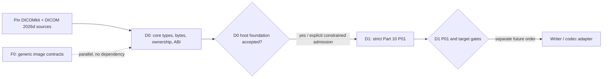

# DICOMflux — D0/D1 Dependency and Acceptance Matrix

**Version:** 0.1.0 · **Issued:** 10 November 2026 · **Status:** PLAN ONLY; all implementation-test statuses NOT RUN.

## Dependency graph



There is **no cyclic dependency**. D0 has no F0 requirement; D1 has no F1 requirement. A later DICOMflux-to-Flux adapter may consume F1-R but is explicitly outside these work orders. DICOMflux-3D and applications are separate.

## Requirement-to-gate trace

| Gate | Prerequisite | Requirements / acceptance evidence | Status at publication |
|---|---|---|---|
| D0-G01 | Authorised repository and sources | D0-REQ-001/012: exact source, licence, rights, normative snapshot and nominated reviewer | NOT RUN |
| D0-G02 | G01 source readiness | D0-REQ-002/003/004/005/007: validated type/offset/VR/UID/error tests | NOT RUN |
| D0-G03 | G02 | D0-REQ-006/008/009: memory, owner, cancellation and concurrency tests | NOT RUN |
| D0-G04 | G02/03 | D0-REQ-010: external C consumer, versioned ABI, allocator/negative cases | NOT RUN |
| D0-G05 | G02/04 | D0-REQ-011: real CLI version/capabilities, unsupported command statuses | NOT RUN |
| D0-G06 | G02–05 | Native execution Windows/Linux x64+ARM64; Android ARM64 physical; emulator separately | NOT RUN |
| D0-G07 | All D0 evidence | D0-REQ-012: SBOM/notices, exact commands/SHAs, independent review | NOT RUN |
| D1-G01 | Accepted specified D0 revision | D1-REQ-001/002/003: pinned 2026d and P01 fixtures | NOT RUN |
| D1-G02 | D1-G01 | D1-REQ-001..004: Part 10/meta/TS/header; T01–04 | NOT RUN |
| D1-G03 | D1-G02 | D1-REQ-005..008: sequences, private creators, charset; T05–10 | NOT RUN |
| D1-G04 | D1-G03 | D1-REQ-009/010/011/014: bulk, cancellation, resources; T07/11/12 | NOT RUN |
| D1-G05 | D1-G02–04 | D1-REQ-012/013: CLI and independent external consumer | NOT RUN |
| D1-G06 | D1-G02–05 | Actual reader execution on each primary target/device | NOT RUN |
| D1-G07 | D1-G05/06 | Exact capability matrix, notices, source/fixture SHA and reviewer sign-off | NOT RUN |
| D1-G08 (optional) | Dictionary and ambiguity review | Separate Implicit VR Little Endian P02 positive/negative evidence | NOT ADMITTED / NOT RUN |

## Qualification labels

`IMPLEMENTED` means source exists; `BUILT` means compilation/link succeeded; `EXECUTED` means the process actually ran in the named environment; `VERIFIED` means its outputs met independent expected results; `NOT RUN` means no test evidence; `BLOCKED` means an identified prerequisite prevents the action. No status implies clinical qualification. A target-specific hold cannot be transformed into PASS by a host build. Any owner waiver must identify the omitted evidence, reason, risk and permitted scope.

## Milestone handoff rules

1. D0-G02..05 can justify a documented **constrained host admission** for D1 experimentation, with G01 and G07 rights and evidence controls closed, and remaining hardware gates conspicuously open. Full D0 multi-platform acceptance requires G06.
2. D1 may be assigned **only after** an owner/designated integrator records which D0 revision and gates it inherits. D1 shall not reimplement D0's ABI or memory allocator.
3. D1 is independently accepted for P01. P02 needs G08; a successful P01 does not imply Implicit VR support.
4. A future writer, compression adapter or workstation commission is **not** automatically authorised by either acceptance.

## Expected evidence directory for coding agents (future)

```text
evidence/
  SOURCE_REGISTER.md
  REQUIREMENT_TO_TEST.md
  FIXTURE_MANIFEST.json
  EXECUTIONS/<target>/<gate>/commands-and-results.json
  RESOURCE_REPORT.md
  ABI_AND_UNSAFE_REVIEW.md
  RIGHTS_AND_NOTICES.md
  SHA256SUMS.txt
```

No such implementation evidence was produced by the documentation-preparation commission. The files here are review instructions and source observations only.
