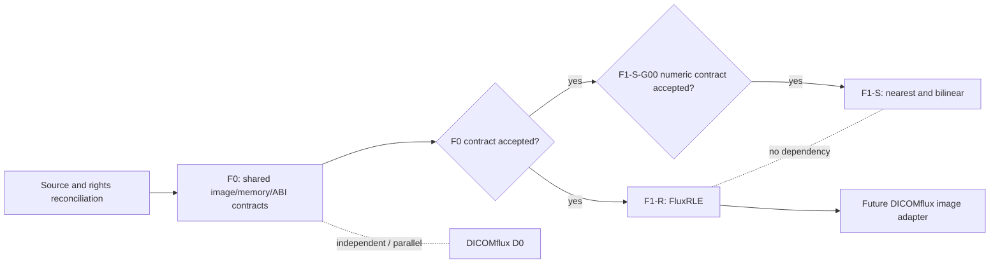

# Flux Imaging Suite — F0/F1 Dependency and Acceptance Matrix

**Version:** 0.1.0 · **Issued:** 10 November 2026 · **Status:** PLANNED; no Rust test was executed by this documentation package.

## Dependency and independence diagram

F1-R **must not** depend on F1-S and vice versa. Neither work order can depend on DICOMflux. The neutral F0 crate may be a dependency of each standalone module; no mandatory sibling codec or umbrella crate is permitted. DICOMflux-3D and application frontends remain out of scope.

## Gate evidence matrix

| Gate | Prerequisite | Required evidence | Status at publication |
|---|---|---|---|
| F0-G01 | Authorised repo/source rights | Exact Swift source SHAs, licences, provenance, common-contract drift disposition and Rust toolchain | NOT RUN |
| F0-G02 | F0-G01 | F0-REQ-002/003/006: descriptor and numeric oracle tests, checked last-byte/overlap cases | NOT RUN |
| F0-G03 | F0-G02 | F0-REQ-004/005: one-writer, immutable readers, seal/invalidate, cancellation and retirement | NOT RUN |
| F0-G04 | F0-G02/03 | F0-REQ-007..011: quotas, copy policy, fidelity/error reports, cancellation | NOT RUN |
| F0-G05 | F0-G04 | F0-REQ-001/012: independent Rust consumer and external C ABI consumer | NOT RUN |
| F0-G06 | F0-G04/05 | F0-REQ-013: genuine CLI capabilities, honest unsupported operations | NOT RUN |
| F0-G07 | F0-G02..06 | Named native targets execute consumer; Android ARM64 on physical device | NOT RUN |
| F0-G08 | All F0 gates | F0-REQ-014: source/fixture integrity, SBOM/notices, reviewer sign-off | NOT RUN |
| F1-R-G01 | Admitted F0 plus Annex G | F1-R-REQ-001..010 source, rights and selected 8/16-bit mono profile | NOT RUN |
| F1-R-G02 | F1-R-G01 | PackBits exact vectors R-T01/02/03/07 and malformed bounds | NOT RUN |
| F1-R-G03 | F1-R-G02 | Strict 64-byte frame header, MSB byte-plane, logical/raw fidelity R-T04/05/06/09 | NOT RUN |
| F1-R-G04 | F1-R-G03 | Caller buffers, resource limits, cancellation, CLI, independent codec tests R-T08/09 | NOT RUN |
| F1-R-G05 | F1-R-G04 | Full target executions, performance/copy reports, notices and SHA-256 | NOT RUN |
| F1-S-G00 | Authoritative source or accepted independent convention | Centre mapping, edge, nearest tie, rounding, precision and label policy recorded and independently approved | **OPEN / SOURCE NOT VERIFIED** |
| F1-S-G01 | F0 and G00 | Nearest-neighbour exact matrices and label/padded geometry cases | NOT RUN |
| F1-S-G02 | F1-S-G01 | Bilinear numerical/interpolation, label rejection, signedness and no-silent-conversion tests | NOT RUN |
| F1-S-G03 | F1-S-G02 | Caller buffers, cancellation, CLI and independent consumer | NOT RUN |
| F1-S-G04 | F1-S-G03 | Actual target runs, numerical tolerance/performance, notices and SHA-256 | NOT RUN |

## Reviewer decisions and allowed sequencing

- **F0 and D0** can be implemented in parallel under separate authorisations.
- **F1-R** starts only after the applicable accepted F0 memory/source contract; **F1-S** additionally needs F1-S-G00 for a parity/qualified implementation claim.
- **F1-R acceptance is independent** of missing SwiftResample source and F1-S acceptance. Maintain separate code/evidence/reviewer dispositions.
- A first host-executed slice may be marked provisionally useful without blanket multi-platform qualification; all skipped device/platform gates remain `NOT RUN` or `BLOCKED`.
- Full seven-kernel FluxResample and other Flux codecs require subsequent work orders. Future DICOMflux integration needs its own tests and authorisation.

## Required future executor evidence

Document exact source and rights, compiler/OS/ABI/device, real `cargo` commands, fixture version and SHA, reference oracle, output bytes/tolerance, live allocation/workspace/RSS/transfer measurements, cancellation outcome, negative cases, C ABI/CLI consumers and the independent gate owner. Do not copy historical Swift test counts into Rust acceptance records. A successful self-round-trip is supplementary, not proof of independent correctness.

**Documentation-only package status:** All future implementation gates are unexecuted by this commission.
